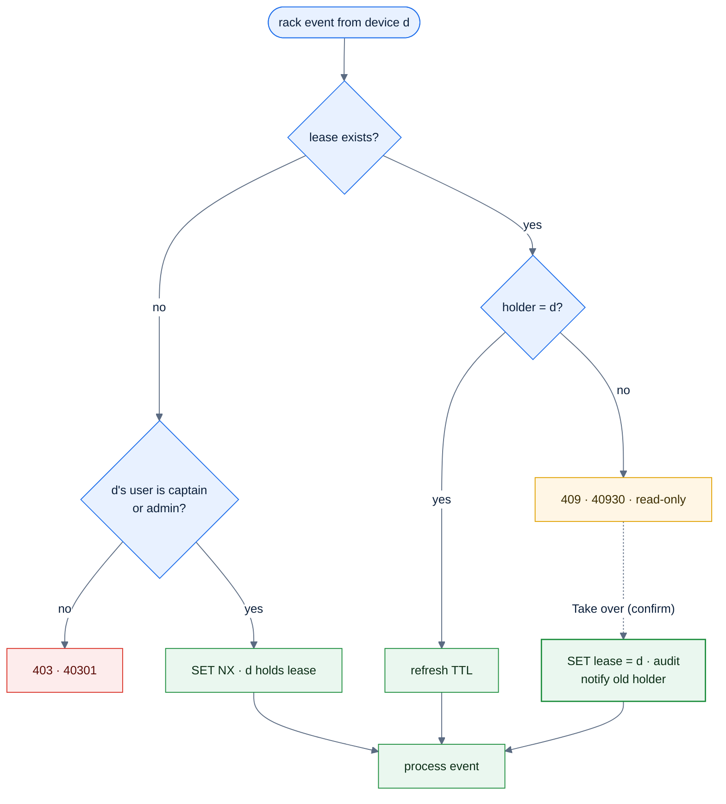
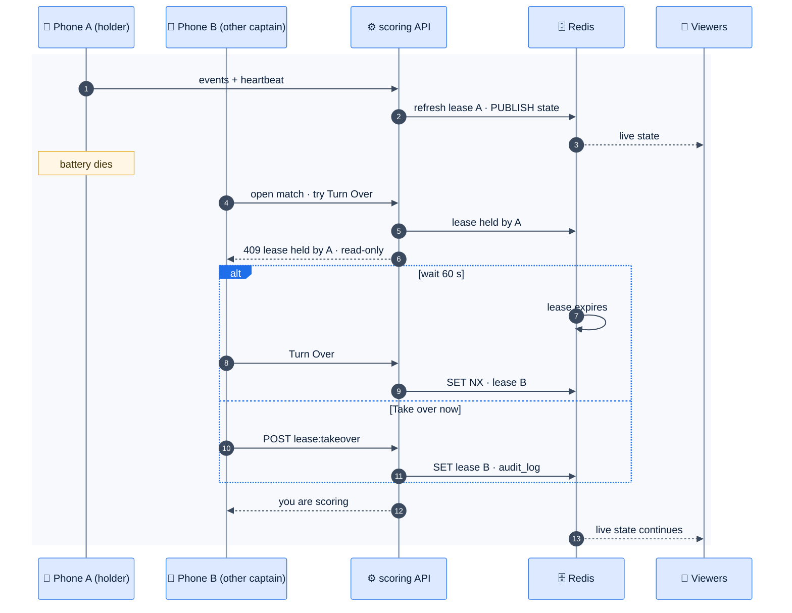

# F30 — Scoring lease & live viewers

> [Feature specs](../README.md) › [E07 — Live Scoring](README.md) › **F30** · Phase 2

| Phase | Status | Rules | Repo refs |
|---|---|---|---|
| 2 | 🎯 | NFR-11 · [08 §1.5, §5](../../08-scorekeeping-engine.md) | — |

## Requirements

*As a captain, only one phone scores each match, so there are no double taps from two devices. If that phone dies, I can take over. Teammates and friends watch the score live.*

| ID | Requirement |
|---|---|
| FR-30.1 | A **lease** per individual match: Redis `SET lease:individual:{id} {deviceId, userId} NX EX 60`, refreshed by every write and by a heartbeat every 20 s |
| FR-30.2 | Only the lease holder can send rack events. Others get `40930 lease held by {name}` and see the match read-only |
| FR-30.3 | **Take over:** a captain of either team or an admin can take the lease with a confirm dialog. The previous holder is told "Scoring moved to {name}" and becomes read-only. It's audited (F41) |
| FR-30.4 | A lease expires after 60 s without a heartbeat; the next eligible device acquires it automatically |
| FR-30.5 | **Live viewers:** `GET /ws/team-matches/{id}` (cookie-authenticated; any signed-in user in Phase 2, public later) receives the full state on connect and a new state on each committed event |
| FR-30.6 | Fan-out: API pods `SUBSCRIBE match:{teamMatchId}` in Redis and push to their local sockets. p95 from commit to viewer < 1 s (NFR-11) |
| FR-30.7 | Fallback: if a WebSocket can't connect, poll `GET /team-matches/{id}/live` every 5 s |
| FR-30.8 | Connection limits: 200 viewers per team match, idle timeout 30 min, ping every 25 s |

## Logic: who may write

## Flow: phone dies mid-match

## UI

| Surface | Detail |
|---|---|
| Live score header | "Scoring on this phone" chip; on other devices "Scored by {name} · Take over" |
| Live view | Same layout as F27 without action buttons, with a pulse dot when connected and "Reconnecting…" otherwise |
| Night page | Each slot shows "Live" with the current games when a match is in progress |

## Edge cases

| ID | Situation | Expected |
|---|---|---|
| EC-30.1 | Redis restarts | Leases vanish; the next write re-acquires. Viewers reconnect and get state from Postgres |
| EC-30.2 | Pod with many sockets is drained | Clients reconnect to another pod (jittered backoff) |
| EC-30.3 | Two take-overs at once | The last write wins in Redis; both actions are audited, and the loser sees read-only |
| EC-30.4 | A viewer's network is slow | The server drops intermediate states and always sends the latest |

## Acceptance criteria

- **AC-30.1** Given phone A holds the lease, when phone B sends an event, then it's rejected with 40930 and B shows read-only.
- **AC-30.2** Given 20 viewers on a match, when an event commits, then all 20 receive it within 1 s at p95 (k6 WS check, F46).
- **AC-30.3** Given a take-over, then `audit_log` has a row with the old holder, the new holder and the time.

## Open questions

- Should live view be public (no sign-in) for spectators? Default: signed-in users only in Phase 2.

---

[← F29](F29-offline-sync.md) · [E07 overview](README.md)
