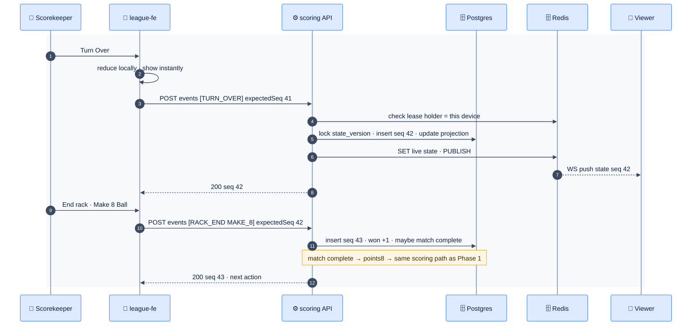

# E07 — Live Scoring

> [Feature specs](../README.md) › **E07**

| | |
|---|---|
| **Goal** | Replace "type the final score" with shot-by-shot scoring on one phone per table: coin flip, lag, every turn, every rack, accolades. It works offline, and everyone else watches live |
| **Phase** | 2 (all features) |
| **Status** | 🎯 Not started. Builds on the E04 put-up/result model and the E06-F42 worker + Redis |
| **Actors** | Scorekeeper (usually a captain), Captains, Live viewers, Admin |
| **Related** | [08 scorekeeping engine](../../08-scorekeeping-engine.md) · [04 §5, §7, §9](../../04-domain-rules.md) · [06 §C](../../06-data-model.md) · [07 §4](../../07-api-design.md) |

## Features by phase

### Phase 1

Nothing. Phase 1 records only the final games per match ([E04-F14](../E04-night-operations/F14-result-entry.md)). Every Phase 2 feature below must keep that path working as a fallback ("Enter final score instead").

### Phase 2

| # | Feature | Status |
|---|---|---|
| F26 | [Coin flip & lag](F26-coin-flip-lag.md) | 🎯 |
| F27 | [Live 8-Ball scoring](F27-live-8ball-scoring.md) | 🎯 |
| F28 | [Racks & accolades](F28-racks-accolades.md) | 🎯 |
| F29 | [Offline scoring sync](F29-offline-sync.md) | 🎯 |
| F30 | [Scoring lease & live viewers](F30-scoring-lease-viewers.md) | 🎯 |

## Phase 2 deep dive

### The model in one sentence

Every tap is an immutable **event**. A pure **reducer**, the same in TypeScript and Go and tested with shared JSON fixtures, folds events into the live state. The server owns ordering (`seq`), stores events in Postgres, and fans state out through Redis.

### Components

```mermaid
%%{init: {"theme": "base", "themeVariables": {"fontFamily": "Arial", "fontSize": "14px", "primaryColor": "#E8F1FF", "primaryBorderColor": "#1F6FEB", "primaryTextColor": "#0B1F3A", "lineColor": "#5B6B82", "secondaryColor": "#EAF7EF", "tertiaryColor": "#FFF6E5", "actorBkg": "#DCE9FF", "actorTextColor": "#0B1F3A", "actorBorder": "#1F6FEB", "actorLineColor": "#8A9BB3", "signalColor": "#3B4A5E", "signalTextColor": "#0B1F3A", "noteBkgColor": "#FFF6E5", "noteBorderColor": "#E0A100", "noteTextColor": "#3D2E00", "activationBkgColor": "#C7DBFF", "activationBorderColor": "#1F6FEB", "sequenceNumberColor": "#FFFFFF", "labelBoxBkgColor": "#1F6FEB", "labelBoxBorderColor": "#1F6FEB", "labelTextColor": "#FFFFFF", "loopTextColor": "#0B1F3A", "clusterBkg": "#F7F9FC", "clusterBorder": "#C9D3E0", "edgeLabelBackground": "#FFFFFF", "transitionLabelColor": "#0B1F3A", "cScale0": "#1F6FEB", "cScaleLabel0": "#FFFFFF", "cScale1": "#1E8E3E", "cScaleLabel1": "#FFFFFF", "cScale2": "#7E57C2", "cScaleLabel2": "#FFFFFF"}}}%%
flowchart LR
  SK(["👤 Scorekeeper"]):::actor
  subgraph FE["📱 Scorer phone · league-fe"]
    direction TB
    LS["<b>LiveScorePage</b><br/>turn · DS · time-out · end rack"]:::fe
    RED["<b>reducer.ts</b><br/>pure · optimistic"]:::fe
    Q["<b>IndexedDB queue</b><br/>pending events"]:::fe
  end
  subgraph BE["⚙️ league-be · internal/scoring"]
    direction TB
    EV["<b>POST /events</b><br/>batch ≤ 50"]:::api
    LE["<b>lease</b><br/>one writer per match"]:::api
    GR["<b>reducer.go</b><br/>authoritative"]:::api
  end
  subgraph DATA["🗄️ Data"]
    direction TB
    ME[("<b>match_events</b><br/>append-only · seq")]:::db
    PR[("<b>projections</b><br/>matches · racks · accolades")]:::db
    RD[("<b>Redis</b><br/>live state · pub/sub")]:::db
  end
  subgraph VW["📱 Viewer phones"]
    direction TB
    WS["<b>WebSocket</b><br/>/ws/team-matches/{id}"]:::api
    LV["<b>LiveViewPage</b><br/>read-only"]:::fe
  end
  SK ==> LS
  LS --> RED
  LS ==> Q
  Q == "sync" ==> EV
  EV --> LE
  EV ==> GR
  GR ==> ME
  GR --> PR
  GR -- "publish" --> RD
  RD -- "push" --> WS --> LV
  class LS,RED,Q,EV,LE,GR,ME,PR,RD,WS,LV planned
  classDef fe fill:#E8F1FF,stroke:#1F6FEB,stroke-width:1.5px,color:#0B1F3A
  classDef api fill:#EAF7EF,stroke:#1E8E3E,stroke-width:1.5px,color:#0B2E16
  classDef db fill:#FFF6E5,stroke:#E0A100,stroke-width:1.5px,color:#3D2E00
  classDef ext fill:#F3EDFF,stroke:#7E57C2,stroke-width:1.5px,color:#25124A
  classDef gap fill:#FDECEC,stroke:#D93025,stroke-width:1.5px,color:#5C0B06
  classDef actor fill:#DCE9FF,stroke:#1F6FEB,stroke-width:2px,color:#0B1F3A,font-weight:bold
  classDef ok fill:#EAF7EF,stroke:#1E8E3E,color:#0B2E16
  classDef warn fill:#FFF6E5,stroke:#E0A100,color:#3D2E00
  classDef bad fill:#FDECEC,stroke:#D93025,color:#5C0B06
  classDef start fill:#E8F1FF,stroke:#1F6FEB,color:#0B1F3A
  classDef planned stroke-dasharray:5 4
```

*Thick path: a tap goes from the scorer's phone to the authoritative log. The right-hand loop fans the new state out to viewers.*

### One rack, end to end

### Individual-match states

```mermaid
%%{init: {"theme": "base", "themeVariables": {"fontFamily": "Arial", "fontSize": "14px", "primaryColor": "#E8F1FF", "primaryBorderColor": "#1F6FEB", "primaryTextColor": "#0B1F3A", "lineColor": "#5B6B82", "secondaryColor": "#EAF7EF", "tertiaryColor": "#FFF6E5", "actorBkg": "#DCE9FF", "actorTextColor": "#0B1F3A", "actorBorder": "#1F6FEB", "actorLineColor": "#8A9BB3", "signalColor": "#3B4A5E", "signalTextColor": "#0B1F3A", "noteBkgColor": "#FFF6E5", "noteBorderColor": "#E0A100", "noteTextColor": "#3D2E00", "activationBkgColor": "#C7DBFF", "activationBorderColor": "#1F6FEB", "sequenceNumberColor": "#FFFFFF", "labelBoxBkgColor": "#1F6FEB", "labelBoxBorderColor": "#1F6FEB", "labelTextColor": "#FFFFFF", "loopTextColor": "#0B1F3A", "clusterBkg": "#F7F9FC", "clusterBorder": "#C9D3E0", "edgeLabelBackground": "#FFFFFF", "transitionLabelColor": "#0B1F3A", "cScale0": "#1F6FEB", "cScaleLabel0": "#FFFFFF", "cScale1": "#1E8E3E", "cScaleLabel1": "#FFFFFF", "cScale2": "#7E57C2", "cScaleLabel2": "#FFFFFF"}}}%%
flowchart LR
  P(["players put up<br/>E04-F13"]):::start --> L["<b>Lag</b><br/>F26"]:::fe
  L --> IP["<b>In progress</b><br/>racks · turns · DS<br/>F27 + F28"]:::api
  IP -- "race reached" --> C["<b>Completed</b><br/>points8 · accolades"]:::ok
  C -. "undo last rack" .-> IP
  IP -. "fallback" .-> M["<b>Final score entry</b><br/>E04-F14"]:::warn
  M --> C
  classDef fe fill:#E8F1FF,stroke:#1F6FEB,stroke-width:1.5px,color:#0B1F3A
  classDef api fill:#EAF7EF,stroke:#1E8E3E,stroke-width:1.5px,color:#0B2E16
  classDef db fill:#FFF6E5,stroke:#E0A100,stroke-width:1.5px,color:#3D2E00
  classDef ext fill:#F3EDFF,stroke:#7E57C2,stroke-width:1.5px,color:#25124A
  classDef gap fill:#FDECEC,stroke:#D93025,stroke-width:1.5px,color:#5C0B06
  classDef actor fill:#DCE9FF,stroke:#1F6FEB,stroke-width:2px,color:#0B1F3A,font-weight:bold
  classDef ok fill:#EAF7EF,stroke:#1E8E3E,color:#0B2E16
  classDef warn fill:#FFF6E5,stroke:#E0A100,color:#3D2E00
  classDef bad fill:#FDECEC,stroke:#D93025,color:#5C0B06
  classDef start fill:#E8F1FF,stroke:#1F6FEB,color:#0B1F3A
  classDef planned stroke-dasharray:5 4
```

### Data delta

| Object | Purpose |
|---|---|
| `match_events (id, team_match_id, individual_match_id, seq, type, payload jsonb, idempotency_key UNIQUE, device_id, actor_user_id, client_ts, server_ts, undone_by_seq)` | Append-only log, `UNIQUE (team_match_id, seq)` |
| `team_matches.state_version int` | Optimistic concurrency (`expectedSeq`) |
| `racks (individual_match_id, rack_no, breaker_side, winner_side, outcome, innings, ds_home, ds_away)` | Projection for stats and the breakdown screen |
| `individual_matches` + `lag_winner_side, breaker_side, innings, ds_home, ds_away, scorekeeper_name` | Projection |
| `player_accolades (player_id, team_match_id, individual_match_id, code, rack_no)` | BR · 8OB · RACKLESS · DOUBLE_STRIKE |
| Redis `live:{teamMatchId}`, `lease:individual:{id}`, channel `match:{teamMatchId}` | Ephemeral, rebuildable from Postgres |

### API surface

| Method | Path | Feature |
|---|---|---|
| `POST` | `/api/v1/team-matches/{id}/coin-flip` | F26 |
| `POST` | `/api/v1/team-matches/{id}/events` | F26–F29 |
| `GET` | `/api/v1/team-matches/{id}/events?after={seq}` | F29 rebase |
| `GET` | `/api/v1/team-matches/{id}/live` | F30 snapshot |
| `POST` | `/api/v1/individual-matches/{id}/lease` · `:takeover` | F30 |
| `GET` | `/ws/team-matches/{id}` | F30 |
