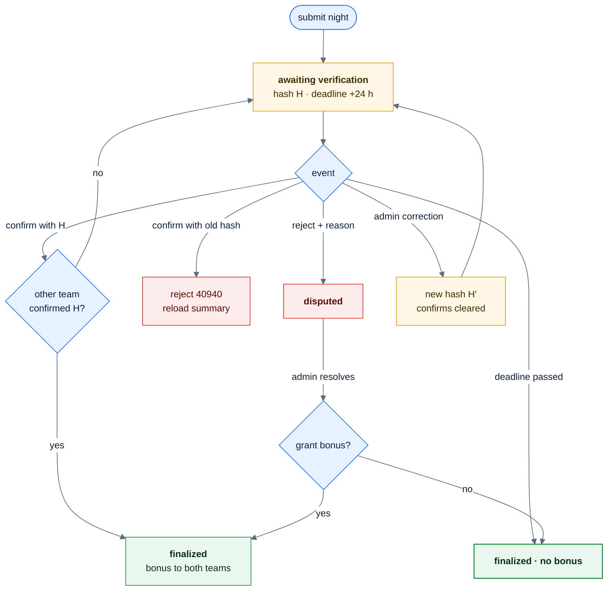
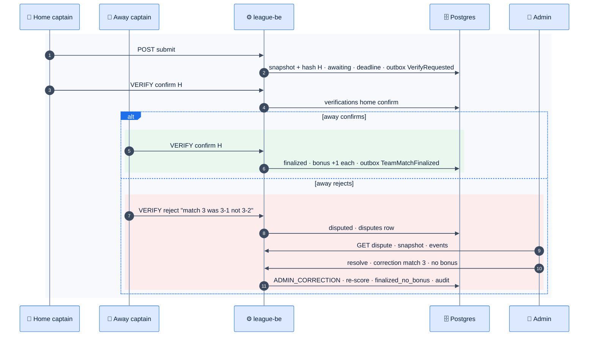

# F31 — Dual-captain verification, bonus, disputes, admin resolution

> [Feature specs](../README.md) › [E08 — Score Verification & Disputes](README.md) › **F31** · Phase 2

| Phase | Status | Rules | Repo refs |
|---|---|---|---|
| 2 | 🎯 | R-110, R-111, R-112, R-113 · [08 §6](../../08-scorekeeping-engine.md) | Phase 1 analogue: `SubmitNightSheet` (parked) and `POST /team-matches/{id}/submit` |

## Requirements

*As a captain, after the last match I check the night's summary and confirm it. When both teams confirm the same record, we each get a bonus. If something's wrong, I reject it with a reason and an admin sorts it out.*

| ID | Requirement |
|---|---|
| FR-31.1 | **Submit** (all 5 slots complete or forfeit) builds a canonical snapshot: per match the member ID, SL, games won/needed (or points/target), points, innings, DS; plus team totals. Keys sorted, no whitespace; `snapshot_hash = sha256(json)` |
| FR-31.2 | Status → `awaiting_verification`, `verification_deadline = ended_at + 24 h` (R-112, configurable per division) |
| FR-31.3 | Each team's captain (or co-captain) sees the summary and sends `VERIFY {decision: confirm|reject, snapshotHash, comment}`. Confirm must carry the current hash; reject needs a comment of ≥ 10 characters |
| FR-31.4 | **Both confirm with the server hash** → `finalized`, and each team gets the bonus: +1 (8-Ball) or +10 (9-Ball) (R-110) |
| FR-31.5 | **Any reject** → `disputed` with a dispute row. **Dual-device mode** (each team scored its own stream): the server diffs the two projections field by field and a mismatch opens a dispute automatically (R-111) |
| FR-31.6 | **Deadline passes** with fewer than two confirms → `finalized_no_bonus` for both teams (worker sweep every 5 min) |
| FR-31.7 | **Admin resolution:** the admin sees the snapshot, the diff, the comments and the event log; applies corrections (as `ADMIN_CORRECTION` events, re-scored by the same rules); chooses whether to grant the bonus; the result is `finalized_no_bonus` or `finalized` (if the bonus is granted). All audited (F41) |
| FR-31.8 | Any correction **before** finalization (by an admin) changes the hash and clears earlier confirms; both captains are asked again |
| FR-31.9 | Notifications (F40): "Please verify tonight's result", "Result disputed", "Dispute resolved" |

## Logic: verification state machine



## Flow: happy path and dispute



## UI

| Screen | Content |
|---|---|
| Verify sheet (captain) | Totals with a crown on the winner, five match rows (players, SL, games, points), the bonus at stake, the deadline countdown, buttons **Confirm** (primary) and **Something's wrong** |
| Reject form | Pick the match(es) affected, free-text reason, submit |
| Night page | Badge: "Waiting for {team} to verify" · "Verified ✓ +1" · "Disputed" · "Final (no bonus)" |
| Admin › Disputes | Queue sorted by age; detail with a side-by-side diff (red cells), comments, event timeline, correction form, "Grant bonus" toggle, required resolution note |

## API & data

```json
{
  "teamId": "<team-uuid>",
  "decision": "confirm",
  "snapshotHash": "9f2c<…>e1",
  "comment": null
}
```

| Error | When |
|---|---|
| `40301` | The caller isn't a captain of that team or an admin |
| `40940` | The hash doesn't match the current snapshot |
| `40941` | The night isn't awaiting verification |
| `40942` | The team has already confirmed this hash |

## Edge cases

| ID | Situation | Expected |
|---|---|---|
| EC-31.1 | Deadline passes with one confirm | `finalized_no_bonus` for **both** teams ([08 §8 #13](../../08-scorekeeping-engine.md)) |
| EC-31.2 | A captain plays for both teams (impossible by roster rules) | Guarded by F39c; verification needs a distinct captain per team |
| EC-31.3 | Captain confirms, then spots an error before the other confirms | They can change to reject until finalized |
| EC-31.4 | Admin edits a finalized night | A post-final correction re-scores and audits; the bonus stays as decided |
| EC-31.5 | Forfeit slots | Included in the snapshot as `forfeit: home|away` |

## Acceptance criteria

- **AC-31.1** Given both captains confirm the same hash, then the night is finalized and each team's standings rise by its points plus 1 (8-Ball).
- **AC-31.2** Given an admin correction after one confirm, then the hash changes and both confirms are needed again.
- **AC-31.3** Given 24 h pass with one confirm, then the status is `finalized_no_bonus` and neither team gets a bonus.
- **AC-31.4** Given a dispute is resolved, then `audit_log` has the corrections, the bonus decision and the note.

## Open questions

- [Q30](../../14-open-questions.md): who may submit, and can co-captains verify?
- Is 24 h the right window for this league?

---

[E08 overview](README.md)
