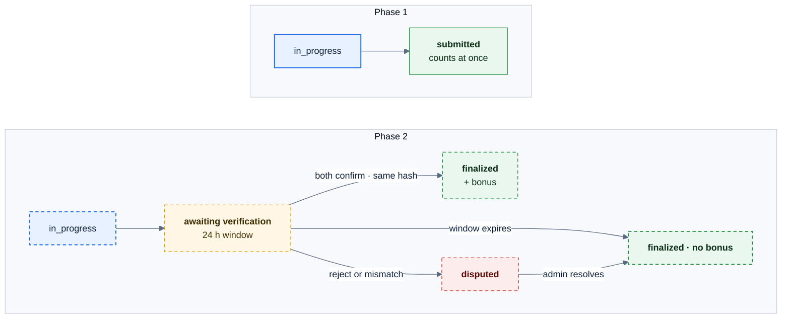
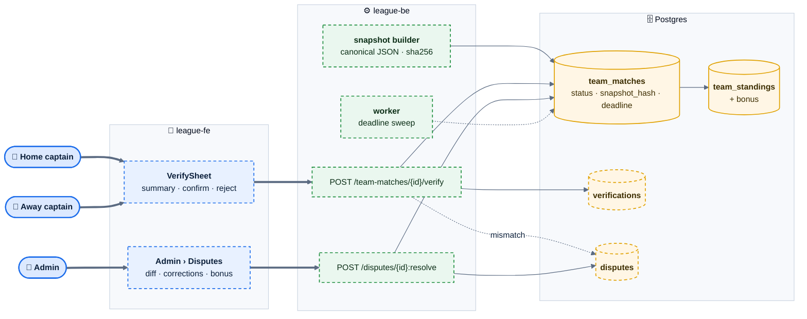

# E08 — Score Verification & Disputes

> [Feature specs](../README.md) › **E08**

| | |
|---|---|
| **Goal** | Both teams agree on the night's record before it counts. Agreement earns a standings bonus; disagreement becomes a dispute that an admin resolves with an audit trail |
| **Phase** | 2 |
| **Status** | 🎯 Not started. Phase 1 has a single `submitted` status ([E04-F15](../E04-night-operations/F15-submit-night.md)) |
| **Actors** | Home captain, Away captain, Admin (League Operator) |
| **Related** | [04 §8](../../04-domain-rules.md) · [08 §6](../../08-scorekeeping-engine.md) · [Q30](../../14-open-questions.md) |

## Features by phase

### Phase 1

Nothing. A night is final as soon as one captain or an admin submits it; admins can still edit afterwards.

### Phase 2

| # | Feature | Status |
|---|---|---|
| F31 | [Dual-captain verification, bonus, disputes, admin resolution](F31-verification-disputes.md) | 🎯 |

## Phase 2 deep dive

### What changes from Phase 1

*Standings and stats count a night only from `finalized` or `finalized · no bonus`. In Phase 1 they count from `submitted`.*

### Components

### Data delta

| Object | Change |
|---|---|
| `team_matches.status` | Adds `awaiting_verification`, `finalized`, `finalized_no_bonus`, `disputed` (Phase 1 `submitted` maps to `awaiting_verification`) |
| `team_matches` | + `snapshot_json jsonb`, `snapshot_hash text`, `verification_deadline timestamptz`, `bonus_home int`, `bonus_away int` |
| `verifications (team_match_id, team_id, decision, snapshot_hash, comment, user_id, at)` | One row per team; latest wins until finalized |
| `disputes (id, team_match_id, opened_by, reason, diff jsonb, status, resolution, corrections jsonb, grant_bonus, resolved_by, resolved_at)` | Admin queue |
| `team_standings` view | Sums only finalized nights and adds the bonus |
