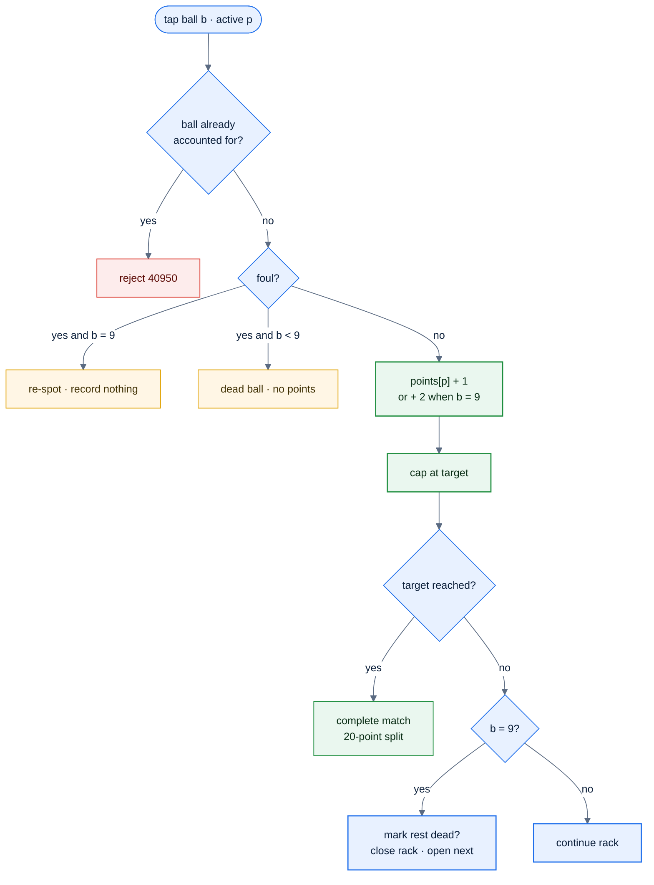
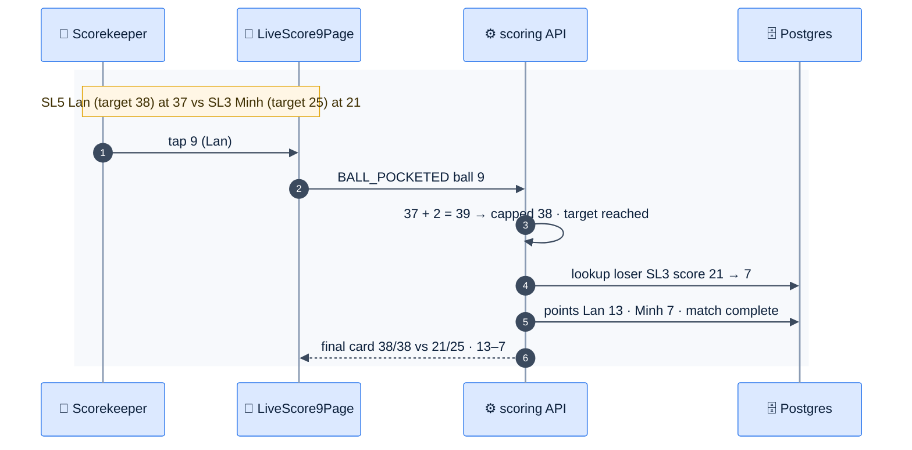

# F32 — 9-Ball scoring + per-format SL

> [Feature specs](../README.md) › [E09 — 9-Ball & Handicap](README.md) › **F32** · Phase 2

| Phase | Status | Rules | Repo refs |
|---|---|---|---|
| 2 | 🎯 | R-080–R-085, R-090, R-091 · [04 §6](../../04-domain-rules.md) · [08 §4.2](../../08-scorekeeping-engine.md) | — |

## Requirements

*As a scorekeeper in a 9-Ball division, I tap each ball as it's pocketed. The app keeps both players' points against their SL targets and splits 20 team points correctly at the end.*

| ID | Requirement |
|---|---|
| FR-32.1 | Divisions have `format`. A player has one current SL **per format** (8-Ball 2–7, 9-Ball 1–9); SL history is kept per format |
| FR-32.2 | Targets by SL: 1→14, 2→19, 3→25, 4→31, 5→38, 6→46, 7→55, 8→65, 9→75 |
| FR-32.3 | Live screen: a 9-ball rack grid (balls 1–9). Tapping a ball credits the **active** player: 1 point, or 2 for the 9 (R-080) |
| FR-32.4 | **Dead ball** (`DEAD_BALL {ball}`): balls 1–8 pocketed on a foul count for nobody. The 9 is never dead; on a foul it's re-spotted and nothing is recorded (R-081, R-082) |
| FR-32.5 | A rack closes when the 9 is credited. Unaccounted balls are offered as "mark as dead?" so that points A + points B + dead = 10 (R-085) |
| FR-32.6 | The match ends the moment a player reaches their target; the recorded score is **capped** at the target (R-083) |
| FR-32.7 | Team points: `loserPts = lookup(loserSL, loserScore)` from the 20-point table; `winnerPts = 20 − loserPts`. PA = 20 per match (R-091) |
| FR-32.8 | Accolades: `9OB` (9 on a legal break) and `BR` (R-084); ball points still count |
| FR-32.9 | Innings, DS and time-outs work as in 8-Ball (F27) |
| FR-32.10 | The 23 SL cap and the put-up rules use the 9-Ball SL in 9-Ball divisions |

## Logic

### Ball event reducer



### 20-point split lookup

```text
points9(loserSL, loserScore):
  row = nine_ball_points where loser_sl = loserSL
                           and loserScore between min_score and max_score
  return (20 - row.loser_pts, row.loser_pts)

example: loser SL3 scored 21 → band 20–21 → 13 / 7
```

## Flow



## UI

| Element | Detail |
|---|---|
| Ball grid | Nine round buttons (56 px) with standard ball colours and numbers. A pocketed ball shows the scorer's initial; a dead ball is struck through |
| Score bar | `31 / 38` with a progress bar per player and the points still needed |
| Rack close | When the 9 is tapped, a sheet lists unaccounted balls: "Mark 3 and 6 as dead?" |
| Breakdown (R-144) | Points/target per player, e.g. `38/38 – 21/25`, and team points |

## Edge cases

| ID | Situation | Expected |
|---|---|---|
| EC-32.1 | 9 pocketed on a foul | Not dead; re-spot; no points; the rack continues ([08 §8 #4](../../08-scorekeeping-engine.md)) |
| EC-32.2 | Player at 37/38 makes the 9 | Recorded 38, the match ends ([08 §8 #5](../../08-scorekeeping-engine.md)) |
| EC-32.3 | Loser scored 0 | 20/0 |
| EC-32.4 | Player has no 9-Ball SL yet | Put-up blocked with "No 9-Ball skill level"; admin sets one |
| EC-32.5 | Forfeit in 9-Ball | 20/0, no MP (F39b) |

## Acceptance criteria

- **AC-32.1** Given the 20-point table, then every SL row covers `0 … target − 1` with no gaps or overlaps (unit test).
- **AC-32.2** Given a rack where A scores 6, B scores 2 and 2 balls are dead, then the rack is valid (6 + 2 + 2 = 10).
- **AC-32.3** Given loser SL3 with 21 points, then team points are 13–7.

## Open questions

- Time-outs per rack for 9-Ball (R-104 default).
- Is the team SL cap also 23 for 9-Ball?

---

[E09 overview](README.md) · [F33 →](F33-sl-suggestions.md)
