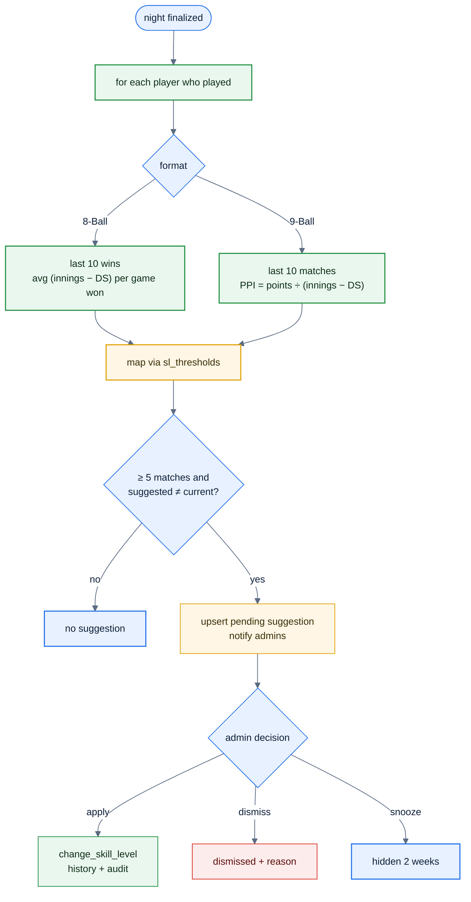
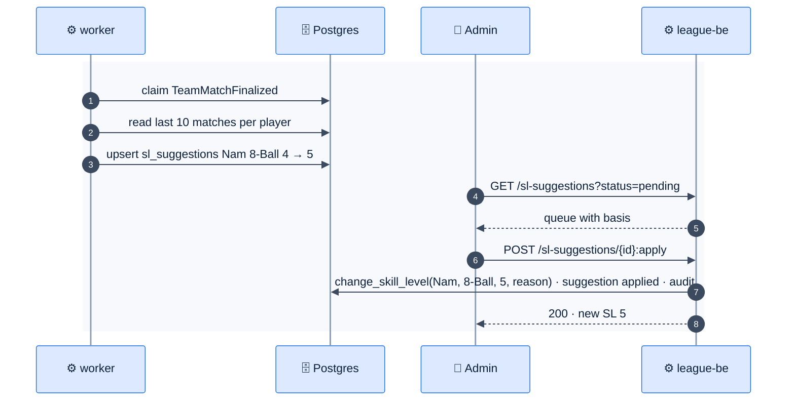

# F33 — Skill-level suggestions

> [Feature specs](../README.md) › [E09 — 9-Ball & Handicap](README.md) › **F33** · Phase 2

| Phase | Status | Rules | Repo refs |
|---|---|---|---|
| 2 | 🎯 | R-120–R-126 · [04 §10](../../04-domain-rules.md) | Phase 1: manual change via `change_skill_level()` ([E05-F18](../E05-roster-admin/F18-skill-level-change.md)) |

## Requirements

*As an admin, after each night the system tells me whose skill level looks wrong, why, and lets me apply the change in one tap with the same history and audit as a manual change.*

| ID | Requirement |
|---|---|
| FR-33.1 | After each finalized night (outbox `TeamMatchFinalized`), the worker recomputes the suggested SL for every player who played |
| FR-33.2 | **8-Ball basis (R-121):** over the last 10 won matches, `avg(effective innings per game won)`, where effective innings = innings − DS |
| FR-33.3 | **9-Ball basis (R-122):** over the last 10 matches, `PPI = Σ points ÷ Σ (innings − DS)` |
| FR-33.4 | Thresholds map the basis to an SL. They're stored in `sl_thresholds (format, sl, min_value, max_value)` and configurable; R-123 says the sources don't give them, so defaults are seeded and marked ⚠️ |
| FR-33.5 | A suggestion is created only when `suggested ≠ current` **and** the player has at least 5 qualifying matches (configurable). An existing pending suggestion for the same player and format is replaced |
| FR-33.6 | The admin queue shows the player, format, current → suggested, the basis (window, values) and a sparkline. Actions: **Apply** (calls `change_skill_level` with reason "Suggested: {basis}"), **Dismiss** (reason required), **Snooze 2 weeks** |
| FR-33.7 | Applied changes follow R-050/R-125: matches already started keep their snapshot; later put-ups use the new SL |
| FR-33.8 | No auto-apply in Phase 2 (R-123); every change needs an admin |

## Logic



## Flow



## API & data

```json
{
  "id": "<suggestion-uuid>",
  "playerId": "<player-uuid>",
  "format": "8_ball",
  "currentSl": 4,
  "suggestedSl": 5,
  "basis": { "window": 10, "metric": "effective_innings_per_win", "value": 3.1 },
  "status": "pending"
}
```

## Edge cases

| ID | Situation | Expected |
|---|---|---|
| EC-33.1 | New player with 2 matches | No suggestion yet |
| EC-33.2 | Admin changes the SL manually while a suggestion is pending | The suggestion is marked superseded |
| EC-33.3 | Matches finished by manual entry (no innings data) | Excluded from the basis |
| EC-33.4 | Suggestion swings back and forth every week | Snooze; consider a hysteresis band in the thresholds |

## Acceptance criteria

- **AC-33.1** Given a fixture of 10 wins with known innings and DS, then the computed basis matches the expected value to 2 decimals.
- **AC-33.2** Given Apply, then `player_skill_levels` has a new row, `audit_log` records it, and the suggestion is `applied`.

## Open questions

- The real threshold values (R-123) must come from the league.

---

[← F32](F32-nine-ball-scoring.md) · [E09 overview](README.md)
