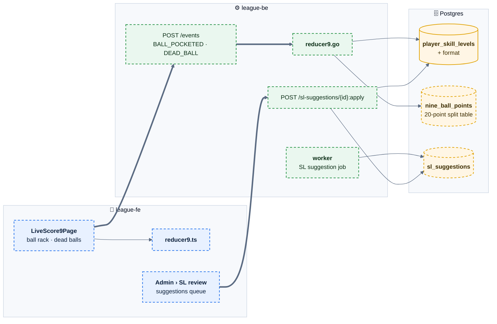

# E09 — 9-Ball & Handicap

> [Feature specs](../README.md) › **E09**

| | |
|---|---|
| **Goal** | Run 9-Ball divisions with point-based scoring and the 20-point split, and keep every player's skill level honest with data-driven suggestions |
| **Phase** | 2 |
| **Status** | 🎯 Not started. Phase 1 is 8-Ball only, with manual SL changes ([E05-F18](../E05-roster-admin/F18-skill-level-change.md)) |
| **Actors** | Scorekeeper, Captains, Admin |
| **Related** | [04 §6, §10](../../04-domain-rules.md) · [08 §4.2](../../08-scorekeeping-engine.md) · [appendix rule tables](../../appendix-rule-tables.md) |

## Features by phase

### Phase 1

Nothing. `divisions.format` is `8_ball` only; SL is one number per player.

### Phase 2

| # | Feature | Status |
|---|---|---|
| F32 | [9-Ball scoring + per-format SL](F32-nine-ball-scoring.md) | 🎯 |
| F33 | [Skill-level suggestions](F33-sl-suggestions.md) | 🎯 |

## Phase 2 deep dive

### 8-Ball vs 9-Ball at a glance

| | 8-Ball (Phase 1) | 9-Ball (F32) |
|---|---|---|
| SL range | 2–7 | 1–9 |
| Match goal | Race in games (race chart) | Target in points (14…75 by SL) |
| Rack | Win or lose the rack | Balls 1–8 = 1 point, 9 = 2 points, 10 per rack |
| Team points per match | 3/0 · 2/1 · 2/0 | 20-point split from the loser's SL and score |
| Max per night | 15 + 1 bonus | 100 + 10 bonus |
| Team SL cap | 23 | 23 (bylaw) |
| SL basis (F33) | Effective innings per won game, last 10 wins | Points per inning (PPI), last 10 matches |

### Components

### Data delta

| Object | Change |
|---|---|
| `divisions.format` | `8_ball` · `9_ball` |
| `player_skill_levels` | + `format`; current SL is per `(player_id, format)` |
| `individual_matches` | + `target_home`, `target_away`, `points_scored_home/away` (9-Ball) |
| `nine_ball_targets (sl, target)`, `nine_ball_points (loser_sl, min_score, max_score, loser_pts)` | Seeded reference tables, tested for contiguity |
| `racks` | + `balls jsonb`, `dead_balls int` (9-Ball) |
| `sl_suggestions (id, player_id, format, current_sl, suggested_sl, basis jsonb, status, decided_by, decided_at)` | F33 |
