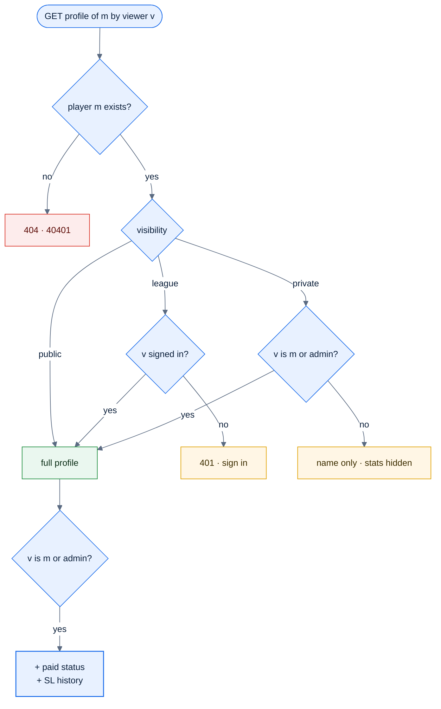
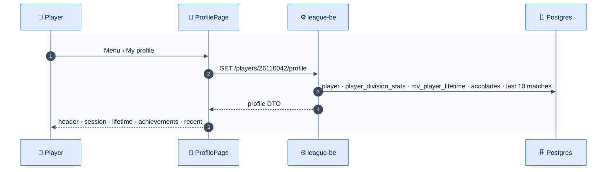

# F34 — Player profile

> [Feature specs](../README.md) › [E10 — Profile & Standings](README.md) › **F34** · Phase 2

| Phase | Status | Rules | Repo refs |
|---|---|---|---|
| 2 | 🎯 | [04 §9, §12](../../04-domain-rules.md) | Phase 1 data: `player_division_stats` view, `players_stats` (E02-F8) |

## Requirements

*As a player, I open my profile and see my current SL per format, my record this session and overall, my achievements, and my recent matches.*

| ID | Requirement |
|---|---|
| FR-34.1 | Route `/players/:memberId`; "My profile" in the header menu opens the signed-in user's own |
| FR-34.2 | Header: name, member ID, current SL per format, team(s) this session, paid status (own profile and admins only) |
| FR-34.3 | **Session** card (per division): MP, MW, Win % (2 decimals), total points, PPM, % points available (PA = 3 for 8-Ball, 20 for 9-Ball) |
| FR-34.4 | **Lifetime** card: MP, MW, Win %, DS average, matches in the last 2 years, last date played |
| FR-34.5 | **Achievements**: counters for BR, 8OB, 9OB, Rackless, Double-strike, with the date of the latest |
| FR-34.6 | **Recent matches**: last 10 individual matches with opponent, SLs, score (games or points/target), points, result chip; tap opens the night breakdown |
| FR-34.7 | **SL history** (own profile and admins): date, format, old → new, reason |
| FR-34.8 | Visibility: `league` (signed-in users) by default; the player can choose `public` or `private` (name and stats visible only to them and admins) |
| FR-34.9 | Forfeits are excluded from MP and Win % (04 §12) |

## Logic: metric formulas

| Metric | Formula | Example (04 §12) |
|---|---|---|
| Win % | `MW ÷ MP × 100` | 3 / 7 = 42.86 % |
| PPM | `total points ÷ MP` | 7 / 7 = 1.00 |
| % PA | `total points ÷ (MP × PA)` | 7 / 21 = 33 % |
| DS avg | `Σ DS ÷ MP` | — |



## Flow



## API & data

```json
{
  "memberId": "26110042",
  "name": "<player name>",
  "skillLevels": [{ "format": "8_ball", "sl": 5 }],
  "session": { "divisionId": "<division-uuid>", "mp": 7, "mw": 3, "winPct": 42.86, "points": 7, "ppm": 1.0, "pctPointsAvailable": 33.33 },
  "lifetime": { "mp": 54, "mw": 29, "winPct": 53.7, "dsAvg": 0.8, "mpLast2y": 41, "lastPlayedAt": "2026-11-03" },
  "accolades": { "BR": 2, "8OB": 1, "9OB": 0, "RACKLESS": 3, "DOUBLE_STRIKE": 0 },
  "recent": []
}
```

## Edge cases

| ID | Situation | Expected |
|---|---|---|
| EC-34.1 | MP = 0 | Win %, PPM and % PA show "—", never NaN or 0 % |
| EC-34.2 | Player on two teams in different divisions | One session card per division |
| EC-34.3 | Lifetime view not yet refreshed after tonight | The session card is live; lifetime shows "Updated {time}" |

## Acceptance criteria

- **AC-34.1** Given 3 wins in 7 matches and 7 points in 8-Ball, then the session card shows 42.86 %, 1.00 and 33 %.
- **AC-34.2** Given a private profile, when another player opens it, then stats are hidden.

## Open questions

- Should lifetime stats include matches from before the app (paper records)?

---

[E10 overview](README.md) · [F35 →](F35-public-standings.md)
