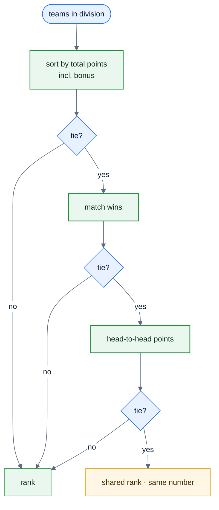
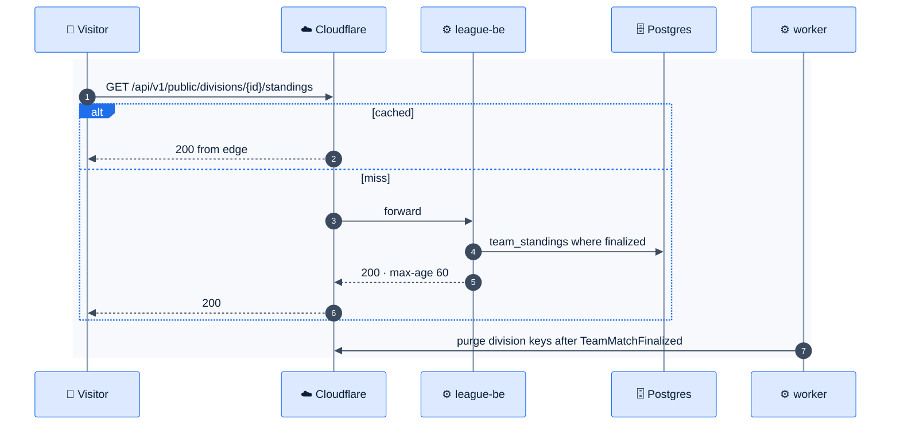

# F35 — Public standings

> [Feature specs](../README.md) › [E10 — Profile & Standings](README.md) › **F35** · Phase 2

| Phase | Status | Rules | Repo refs |
|---|---|---|---|
| 2 | 🎯 | R-110, R-140–R-145 · [04 §13](../../04-domain-rules.md) | Phase 1 data: `team_standings` view (E02-F8) |

## Requirements

*As anyone, players, friends or venue owners, I open a link and see the division table and every result, without signing in.*

| ID | Requirement |
|---|---|
| FR-35.1 | Public routes `/standings/:divisionId` and `/teams/:teamNumber` that work without a session |
| FR-35.2 | Standings table: rank, team number + name, nights played, team points (including bonus), bonus, match wins, Win %. Sorted by points, then match wins, then head-to-head points |
| FR-35.3 | Results list per team, sorted by date (R-145): opponent, final score, date, venue; completed cards are green for the winner (R-140); upcoming cards show a blue date and time with the score hidden (R-141); bye and no-play are neutral, non-clickable (R-142) |
| FR-35.4 | Tapping a completed result opens the public night breakdown (R-144): totals with a crown, five match blocks with name, SL, LAG badge and games or points |
| FR-35.5 | Only nights in `finalized` or `finalized_no_bonus` count (E08); in Phase 1 mode, `submitted` |
| FR-35.6 | Public payloads never include emails, user IDs, paid status or private-profile stats (those players show as "Player {memberId}") |
| FR-35.7 | `Cache-Control: public, max-age=60, stale-while-revalidate=300`; Cloudflare caches it; a finalized night purges the division's keys (worker) |
| FR-35.8 | Share button uses the Web Share API with the canonical URL; Open Graph tags give a readable preview in Zalo/Facebook |

## Logic: ranking

## Flow

## UI

| State | Shown |
|---|---|
| Loading | Table skeleton with 8 rows |
| Empty | "No results yet this session" |
| Unknown division | 404 page with a link to the schedule |
| ≥ 1024 px | Standings on the left, the selected team's results on the right |

## Edge cases

| ID | Situation | Expected |
|---|---|---|
| EC-35.1 | A dispute is pending | That night isn't counted; the card shows "Under review" |
| EC-35.2 | Admin correction after finalize | Purge and recompute |
| EC-35.3 | A team withdraws mid-season | Kept in the table, marked "Withdrawn" (policy question) |

## Acceptance criteria

- **AC-35.1** Given no cookie, when the standings URL is opened, then the table renders.
- **AC-35.2** Given a public payload, then it contains no `email`, `userId` or `paid` fields (contract test).
- **AC-35.3** Given a newly finalized night, then the standings reflect it within 2 minutes.

## Open questions

- Tie-break order: is head-to-head the league's rule?

---

[← F34](F34-player-profile.md) · [E10 overview](README.md)
