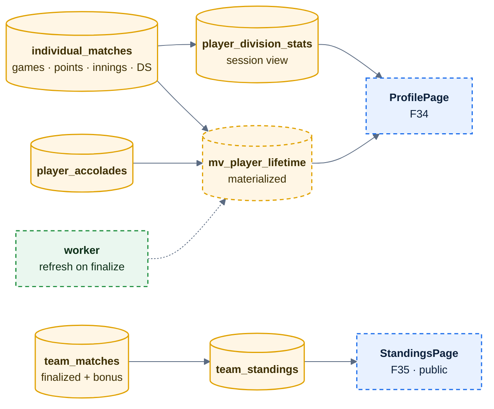
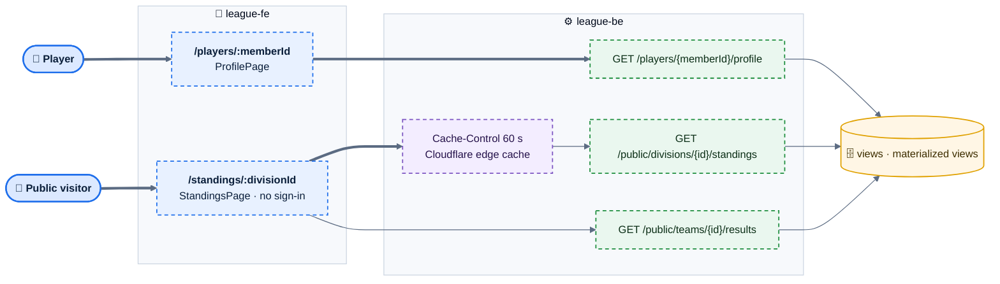

# E10 — Profile & Standings

> [Feature specs](../README.md) › **E10**

| | |
|---|---|
| **Goal** | Players see their own record and achievements; everyone, signed in or not, sees division standings and results |
| **Phase** | 2 |
| **Status** | 🎯 Not started. Phase 1 already computes `player_division_stats` and `team_standings` (E02-F8) and shows per-session stats in the roster (E03-F12) |
| **Actors** | Player, Captain, Public visitor |
| **Related** | [04 §12, §13](../../04-domain-rules.md) · [06 views](../../06-data-model.md) · [08 §7](../../08-scorekeeping-engine.md) |

## Features by phase

### Phase 1

The data exists but no dedicated screen: roster rows show MW/MP and points for the session.

### Phase 2

| # | Feature | Status |
|---|---|---|
| F34 | [Player profile](F34-player-profile.md) | 🎯 |
| F35 | [Public standings](F35-public-standings.md) | 🎯 |

## Phase 2 deep dive

### Where the numbers come from

*Session numbers come from live views (always exact). Lifetime numbers come from a materialized view refreshed by the worker after each finalized night.*

### Components

### Data delta

| Object | Purpose |
|---|---|
| `mv_player_lifetime (player_id, format, mp, mw, win_pct, ds_avg, br, eob, nob, rackless, double_strike, last_played_at, mp_2y)` | Lifetime profile metrics |
| `team_standings` view | + bonus, + tie-break columns (points, then match wins, then head-to-head) |
| `players.profile_visibility` | `league` (default) · `public` · `private` |
| Public routes under `/api/v1/public/*` | No cookie, no CSRF, cacheable, only public fields |
