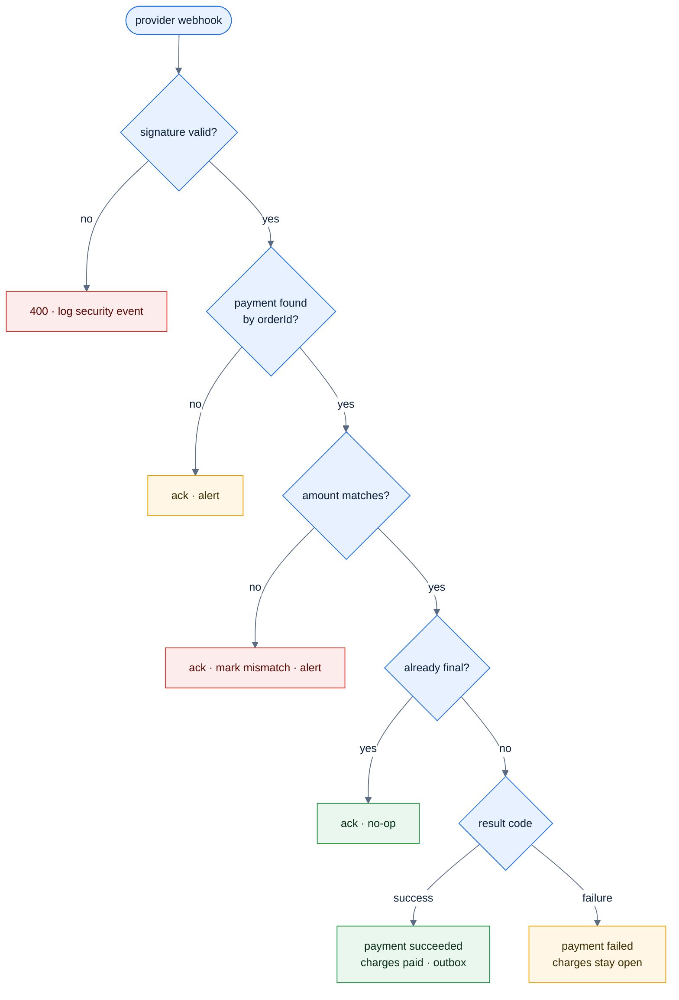
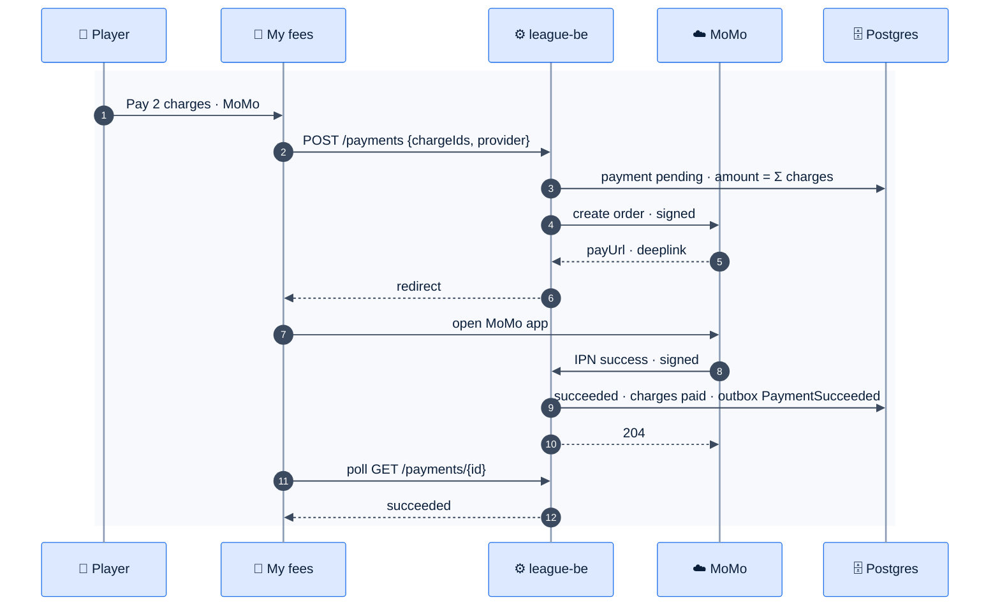

# F36 — Fees with MoMo / ZaloPay

> [Feature specs](../README.md) › [E11 — Payments & Notifications](README.md) › **F36** · Phase 2

| Phase | Status | Rules | Repo refs |
|---|---|---|---|
| 2 | 🎯 | R-014 (paid member) · [11 §7](../../11-security-and-roles.md) | Phase 1: `memberships.paid` flag set by an admin |

## Requirements

*As a player, I see what I owe and pay it from my phone with MoMo or ZaloPay. As an admin, I see who has paid without chasing cash.*

| ID | Requirement |
|---|---|
| FR-36.1 | Fee schedule per division: membership fee (per session) and weekly fee (per night played). Amounts in VND, integers |
| FR-36.2 | Charges are created by events: membership on roster add (`RosterChanged`), weekly on `TeamMatchFinalized` for each player who played (forfeiting teams still owe, F39b) |
| FR-36.3 | "My fees" lists open charges and history. **Pay** selects one or more charges, then the provider |
| FR-36.4 | Create order server-side with the provider's signed API (HMAC-SHA256 with the partner secret from Secret Manager); `orderId = <payment uuid>`; redirect to the provider deep link or QR |
| FR-36.5 | **Webhook (IPN/callback)** is the only source of truth: verify the signature, check the amount and order ID, update in one transaction, respond in the provider's format. Idempotent by `provider_order_id` |
| FR-36.6 | The browser return page only shows "Checking payment…" and polls our API; it never marks anything paid |
| FR-36.7 | A daily reconciliation job queries the provider for orders pending > 15 min |
| FR-36.8 | Admins can record a manual payment (cash or transfer) or waive a charge, with a reason (audited) |
| FR-36.9 | A membership is paid ⇔ it has no open membership charge. The put-up and roster rules keep using that |
| FR-36.10 | Refunds are manual in the provider portal and recorded by the admin in Phase 2 |

## Logic: webhook handling

## Flow

## Edge cases

| ID | Situation | Expected |
|---|---|---|
| EC-36.1 | Webhook arrives twice | The second is a no-op |
| EC-36.2 | Webhook arrives before the browser returns | Normal; the return page sees `succeeded` |
| EC-36.3 | Charge waived while a payment is pending | The payment still settles; the admin refunds manually; flagged |
| EC-36.4 | User closes MoMo without paying | Stays pending; reconciliation marks it failed or expired |

## Acceptance criteria

- **AC-36.1** Given a forged webhook, then nothing changes and a security log line exists.
- **AC-36.2** Given a successful MoMo sandbox payment, then the charges are paid and the player becomes put-up eligible.

## Open questions

- Which provider first, MoMo or ZaloPay? Are the fees per night or per session?

---

[E11 overview](README.md) · [F40 →](F40-notifications.md)
