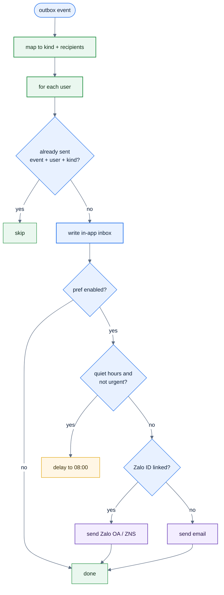
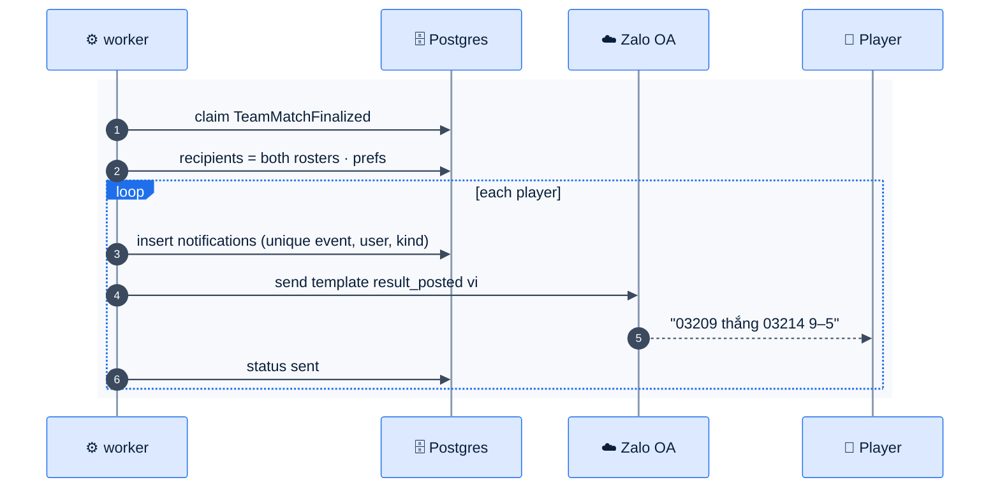

# F40 — Notifications

> [Feature specs](../README.md) › [E11 — Payments & Notifications](README.md) › **F40** · Phase 2

| Phase | Status | Rules | Repo refs |
|---|---|---|---|
| 2 | 🎯 | [08 §7](../../08-scorekeeping-engine.md) | — |

## Requirements

*As a player, I'm told about my matches, results, fees and skill changes in Zalo, in Vietnamese, without spam. I can turn off what I don't want.*

| ID | Requirement |
|---|---|
| FR-40.1 | Channels: **Zalo OA / ZNS** (primary, needs the user's Zalo ID from F37 and OA follow, or a ZNS template with a phone number), **email** (fallback), **in-app inbox** (always) |
| FR-40.2 | Kinds and triggers: below. Each kind has a template per locale (vi, en) and a channel default |
| FR-40.3 | Preferences per user and kind; transactional kinds (payment receipt, dispute) can't be fully disabled; they fall back to in-app |
| FR-40.4 | Sending only from the worker (F42), keyed by `(event_id, user_id, kind)` so retries never duplicate |
| FR-40.5 | Quiet hours 23:00–08:00 ICT for non-urgent kinds; queued until the morning |
| FR-40.6 | ZNS templates must be pre-approved by Zalo; template IDs live in config |
| FR-40.7 | In-app inbox: bell icon with unread count, list, mark as read |

## Kinds

| Kind | Trigger | Who | Urgent |
|---|---|---|---|
| `match_reminder` | 10:00 on match day (scheduler) | Both rosters | No |
| `verify_request` | `TeamMatchSubmitted` (E08) | Both captains | Yes |
| `result_posted` | `TeamMatchFinalized` | Both rosters | No |
| `dispute_update` | `DisputeOpened` / `Resolved` | Captains, admins | Yes |
| `fee_due` | Charge created (F36) | The player | No |
| `payment_receipt` | `PaymentSucceeded` | The payer | Yes |
| `sl_changed` | `SkillLevelChanged` | The player | No |
| `roster_request` | Late add pending (F39c) | Admins | Yes |

## Logic: dispatch

## Flow

## Edge cases

| ID | Situation | Expected |
|---|---|---|
| EC-40.1 | Zalo rejects (user unfollowed the OA) | Mark the channel unreachable; fall back to email next time |
| EC-40.2 | 200 players in one finalize | Batched with a rate limit per Zalo's quota |
| EC-40.3 | Player has no Zalo and no email | In-app only |

## Acceptance criteria

- **AC-40.1** Given a worker retry after sending, then the player gets one message, not two.
- **AC-40.2** Given `sl_changed` at 23:30, then it's delivered at 08:00; `dispute_update` at 23:30 is sent at once.

## Open questions

- Zalo OA account ownership, ZNS budget, and template approval timeline.

---

[← F36](F36-fees-payments.md) · [E11 overview](README.md)
