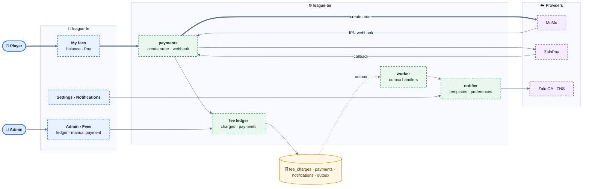
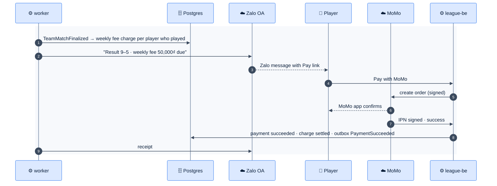

# E11 — Payments & Notifications

> [Feature specs](../README.md) › **E11**

| | |
|---|---|
| **Goal** | Collect membership and weekly fees through the wallets Vietnamese players already use, and reach players where they already are (Zalo) |
| **Phase** | 2 |
| **Status** | 🎯 Not started. Phase 1 has only a manual `paid` flag on membership, set by an admin, which gates put-up and roster adds |
| **Actors** | Player, Captain, Admin, MoMo / ZaloPay, Zalo Official Account |
| **Related** | [04 §3](../../04-domain-rules.md) · [11 security](../../11-security-and-roles.md) · [E06-F42 worker](../E06-platform-delivery/F42-worker-outbox-redis.md) |

## Features by phase

### Phase 1

A manual paid flag. An admin marks a membership paid after cash or bank transfer, and unpaid players can't be put up.

### Phase 2

| # | Feature | Status |
|---|---|---|
| F36 | [Fees with MoMo / ZaloPay](F36-fees-payments.md) | 🎯 |
| F40 | [Notifications](F40-notifications.md) | 🎯 |

## Phase 2 deep dive

### Components

### Money and message path for one night

### Data delta

| Object | Purpose |
|---|---|
| `fee_schedules (division_id, kind membership|weekly, amount_vnd, due_rule)` | Fee configuration |
| `fee_charges (id, player_id, team_match_id NULL, kind, amount_vnd, status open|paid|waived, due_at)` | What's owed |
| `payments (id, provider, provider_order_id UNIQUE, amount_vnd, status, raw jsonb, charge_ids uuid[])` | What's paid; the webhook is idempotent on `provider_order_id` |
| `memberships.paid` | Becomes derived: paid ⇔ no open membership charge |
| `notification_prefs (user_id, channel, kind, enabled)`, `notifications (id, user_id, kind, channel, payload, status, sent_at)` | F40 |
