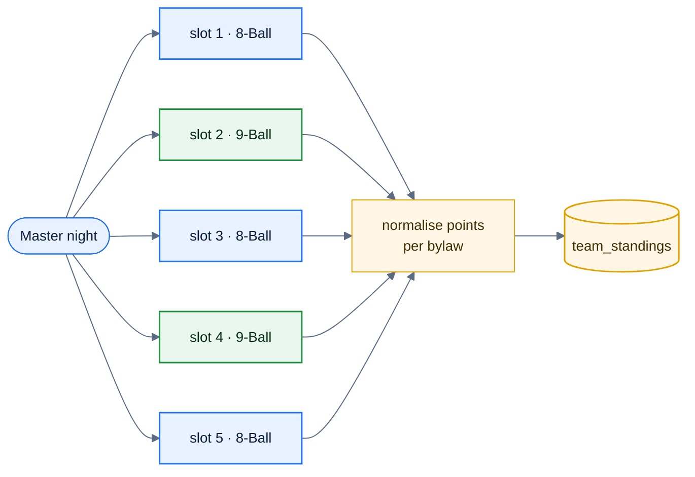

# F47 — Master division

> [Feature specs](../README.md) › [E12 — Growth](README.md) › **F47** · Phase 3

| Phase | Status | Rules |
|---|---|---|
| 3 | 🎯 outline | [04 §2](../../04-domain-rules.md) · [Q5](../../14-open-questions.md) |

## Requirements

| ID | Requirement |
|---|---|
| FR-47.1 | A division format "Master" that mixes 8-Ball and 9-Ball in one team night (for example, matches 1, 3, 5 in 8-Ball and 2, 4 in 9-Ball, set by bylaw) |
| FR-47.2 | Each slot uses the player's SL **for that slot's format**; the team cap applies per format or as a combined index (to be decided) |
| FR-47.3 | Team points are normalised so both formats weigh the same (for example, 8-Ball points × 20/3) or are kept separate in standings |
| FR-47.4 | Accolades (including DOUBLE_STRIKE) count across formats in the same night |

## Key rules and assumptions

- Builds directly on per-format SL (F32). No new scoring engine, only a slot → format map.
- The put-up cap check must run with the format of the slot being filled.

## Diagram

## Open questions

- Slot-to-format pattern, cap rule, and normalisation: all need the league's bylaw.

---

[E12 overview](README.md) · [F48 →](F48-tournaments.md)
