# F48 — Tournaments & brackets

> [Feature specs](../README.md) › [E12 — Growth](README.md) › **F48** · Phase 3

| Phase | Status | Rules |
|---|---|---|
| 3 | 🎯 outline | [04 §12 championship SL](../../04-domain-rules.md) |

## Requirements

| ID | Requirement |
|---|---|
| FR-48.1 | Admins create a tournament: format, singles or teams, bracket type (single elimination, double elimination, round robin + knockout), entry fee, dates, venue(s) |
| FR-48.2 | Entry is open to qualified players or teams (F54) or to everyone, with payment through F36 |
| FR-48.3 | Seeding by standings or random; byes for non-power-of-two fields |
| FR-48.4 | Each bracket match is an individual match scored with the live engine (E07); the winner advances automatically |
| FR-48.5 | Public bracket page with live scores (F30) and a shareable link |
| FR-48.6 | Handicap uses the player's **championship SL** (lowest attainable SL over recent sessions) where the rules say so |

## Key rules and assumptions

- Reuse `individual_matches` and the event log; a tournament match has no `team_match_id` but a `bracket_slot_id`.
- Double elimination needs a losers' bracket and a possible reset final.

## Diagram

```mermaid
%%{init: {"theme": "base", "themeVariables": {"fontFamily": "Arial", "fontSize": "14px", "primaryColor": "#E8F1FF", "primaryBorderColor": "#1F6FEB", "primaryTextColor": "#0B1F3A", "lineColor": "#5B6B82", "secondaryColor": "#EAF7EF", "tertiaryColor": "#FFF6E5", "actorBkg": "#DCE9FF", "actorTextColor": "#0B1F3A", "actorBorder": "#1F6FEB", "actorLineColor": "#8A9BB3", "signalColor": "#3B4A5E", "signalTextColor": "#0B1F3A", "noteBkgColor": "#FFF6E5", "noteBorderColor": "#E0A100", "noteTextColor": "#3D2E00", "activationBkgColor": "#C7DBFF", "activationBorderColor": "#1F6FEB", "sequenceNumberColor": "#FFFFFF", "labelBoxBkgColor": "#1F6FEB", "labelBoxBorderColor": "#1F6FEB", "labelTextColor": "#FFFFFF", "loopTextColor": "#0B1F3A", "clusterBkg": "#F7F9FC", "clusterBorder": "#C9D3E0", "edgeLabelBackground": "#FFFFFF", "transitionLabelColor": "#0B1F3A", "cScale0": "#1F6FEB", "cScaleLabel0": "#FFFFFF", "cScale1": "#1E8E3E", "cScaleLabel1": "#FFFFFF", "cScale2": "#7E57C2", "cScaleLabel2": "#FFFFFF"}}}%%
flowchart LR
  R(["registration<br/>+ fee"]):::start --> SD["seeding"]:::api --> B["bracket generated"]:::api
  B --> M["match scored live<br/>E07"]:::fe
  M --> A{"winner"}
  A --> NX["advance to next slot"]:::ok
  A -. "double elim" .-> LB["loser to losers' bracket"]:::warn
  NX --> F{"final played?"}
  F -- no --> M
  F -- yes --> CH["champion · accolade"]:::ok
  classDef fe fill:#E8F1FF,stroke:#1F6FEB,stroke-width:1.5px,color:#0B1F3A
  classDef api fill:#EAF7EF,stroke:#1E8E3E,stroke-width:1.5px,color:#0B2E16
  classDef db fill:#FFF6E5,stroke:#E0A100,stroke-width:1.5px,color:#3D2E00
  classDef ext fill:#F3EDFF,stroke:#7E57C2,stroke-width:1.5px,color:#25124A
  classDef gap fill:#FDECEC,stroke:#D93025,stroke-width:1.5px,color:#5C0B06
  classDef actor fill:#DCE9FF,stroke:#1F6FEB,stroke-width:2px,color:#0B1F3A,font-weight:bold
  classDef ok fill:#EAF7EF,stroke:#1E8E3E,color:#0B2E16
  classDef warn fill:#FFF6E5,stroke:#E0A100,color:#3D2E00
  classDef bad fill:#FDECEC,stroke:#D93025,color:#5C0B06
  classDef start fill:#E8F1FF,stroke:#1F6FEB,color:#0B1F3A
  classDef planned stroke-dasharray:5 4
```

## Open questions

- Which tournament formats does the league run today? Who seeds?

---

[← F47](F47-master-division.md) · [E12 overview](README.md) · [F49 →](F49-sandbagging-detection.md)
