# F49 — Sandbagging detection

> [Feature specs](../README.md) › [E12 — Growth](README.md) › **F49** · Phase 3

| Phase | Status | Rules |
|---|---|---|
| 3 | 🎯 outline | R-124 · [04 §10](../../04-domain-rules.md) |

## Requirements

| ID | Requirement |
|---|---|
| FR-49.1 | A nightly job computes anomaly signals per player: sudden PPI drop, DS ratio outliers, high variance in innings per win, much better results in playoffs than in the regular season |
| FR-49.2 | Signals above thresholds create `anomaly_flags` with the evidence (charts, match links) in an admin review queue |
| FR-49.3 | Admin actions: dismiss (with reason), watch, raise SL (via F18 / F33), or refer to the league committee |
| FR-49.4 | Flags are never visible to players; decisions are audited |

## Key rules and assumptions

- Needs rich event data (innings, DS per turn) from E07; nights entered as final scores only are excluded.
- Start with simple z-scores against the player's own history and the division; no ML until there's labelled data.

## Diagram

```mermaid
%%{init: {"theme": "base", "themeVariables": {"fontFamily": "Arial", "fontSize": "14px", "primaryColor": "#E8F1FF", "primaryBorderColor": "#1F6FEB", "primaryTextColor": "#0B1F3A", "lineColor": "#5B6B82", "secondaryColor": "#EAF7EF", "tertiaryColor": "#FFF6E5", "actorBkg": "#DCE9FF", "actorTextColor": "#0B1F3A", "actorBorder": "#1F6FEB", "actorLineColor": "#8A9BB3", "signalColor": "#3B4A5E", "signalTextColor": "#0B1F3A", "noteBkgColor": "#FFF6E5", "noteBorderColor": "#E0A100", "noteTextColor": "#3D2E00", "activationBkgColor": "#C7DBFF", "activationBorderColor": "#1F6FEB", "sequenceNumberColor": "#FFFFFF", "labelBoxBkgColor": "#1F6FEB", "labelBoxBorderColor": "#1F6FEB", "labelTextColor": "#FFFFFF", "loopTextColor": "#0B1F3A", "clusterBkg": "#F7F9FC", "clusterBorder": "#C9D3E0", "edgeLabelBackground": "#FFFFFF", "transitionLabelColor": "#0B1F3A", "cScale0": "#1F6FEB", "cScaleLabel0": "#FFFFFF", "cScale1": "#1E8E3E", "cScaleLabel1": "#FFFFFF", "cScale2": "#7E57C2", "cScaleLabel2": "#FFFFFF"}}}%%
flowchart LR
  EV[("match_events<br/>racks")]:::db --> J["nightly job<br/>signals per player"]:::api
  J --> Z{"z-score above<br/>threshold?"}
  Z -- no --> OK["no flag"]:::ok
  Z -- yes --> FL["anomaly flag<br/>+ evidence"]:::warn --> Q["admin review queue"]:::fe
  Q --> D{"decision"}
  D -- dismiss --> DM["dismissed"]:::fe
  D -- "raise SL" --> SL["F18 change · audit"]:::bad
  classDef fe fill:#E8F1FF,stroke:#1F6FEB,stroke-width:1.5px,color:#0B1F3A
  classDef api fill:#EAF7EF,stroke:#1E8E3E,stroke-width:1.5px,color:#0B2E16
  classDef db fill:#FFF6E5,stroke:#E0A100,stroke-width:1.5px,color:#3D2E00
  classDef ext fill:#F3EDFF,stroke:#7E57C2,stroke-width:1.5px,color:#25124A
  classDef gap fill:#FDECEC,stroke:#D93025,stroke-width:1.5px,color:#5C0B06
  classDef actor fill:#DCE9FF,stroke:#1F6FEB,stroke-width:2px,color:#0B1F3A,font-weight:bold
  classDef ok fill:#EAF7EF,stroke:#1E8E3E,color:#0B2E16
  classDef warn fill:#FFF6E5,stroke:#E0A100,color:#3D2E00
  classDef bad fill:#FDECEC,stroke:#D93025,color:#5C0B06
  classDef start fill:#E8F1FF,stroke:#1F6FEB,color:#0B1F3A
  classDef planned stroke-dasharray:5 4
```

## Open questions

- Which signals does the league trust, and who reviews the flags?

---

[← F48](F48-tournaments.md) · [E12 overview](README.md) · [F50 →](F50-multi-league.md)
