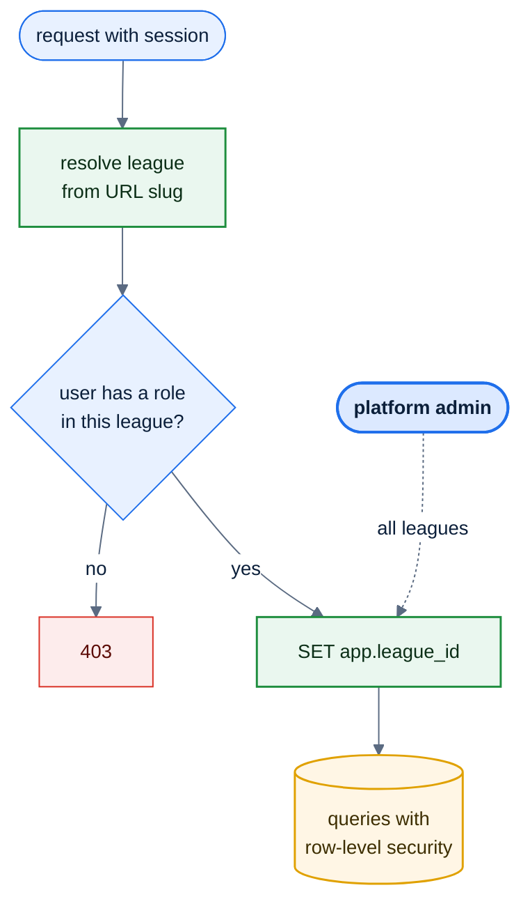

# F50 — Multi-league & LO roles

> [Feature specs](../README.md) › [E12 — Growth](README.md) › **F50** · Phase 3

| Phase | Status | Rules |
|---|---|---|
| 3 | 🎯 outline | [04 §1](../../04-domain-rules.md) · [11 RBAC](../../11-security-and-roles.md) |

## Requirements

| ID | Requirement |
|---|---|
| FR-50.1 | A `leagues` tenant: name, region, bylaws (`jsonb`), fee schedule, branding |
| FR-50.2 | Roles become scoped: **Platform admin** (all leagues), **League Operator** (one league), Captain (team), Player |
| FR-50.3 | Every query is filtered by `league_id`; Postgres row-level security as a second guard |
| FR-50.4 | A player can belong to several leagues with one account and one member ID |
| FR-50.5 | League switcher in the header; the URL carries the league slug (`/l/hcm/...`) |
| FR-50.6 | Platform admins can create a league and invite its LO |

## Key rules and assumptions

- Phase 1 has a single implicit league. Migration: create one `leagues` row and backfill `league_id`.
- Member IDs stay global (R-132); team IDs are already region-coded (R-131).

## Diagram

## Open questions

- Shared or separate player SLs across leagues? Billing per league?

---

[← F49](F49-sandbagging-detection.md) · [E12 overview](README.md) · [F51 →](F51-sponsors.md)
