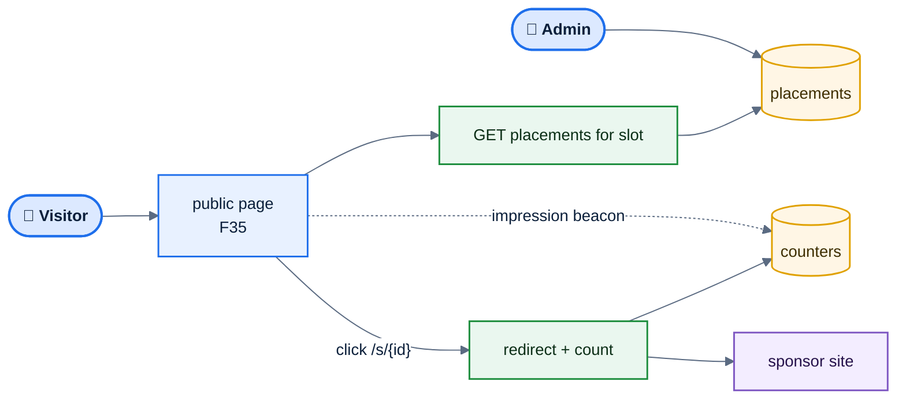

# F51 — Sponsor placements

> [Feature specs](../README.md) › [E12 — Growth](README.md) › **F51** · Phase 3

| Phase | Status | Rules |
|---|---|---|
| 3 | 🎯 outline | — |

## Requirements

| ID | Requirement |
|---|---|
| FR-51.1 | Admins define placements: slot (standings header, night breakdown footer, tournament page), sponsor, image, link, start and end dates, target (league, division, venue) |
| FR-51.2 | Placements render only on public and read-only screens, never on the scoring or put-up screens |
| FR-51.3 | Impressions and clicks are counted server-side without personal data; monthly report per sponsor |
| FR-51.4 | Images are uploaded to Cloud Storage and served through the CDN; size and format limits |

## Key rules and assumptions

- No third-party ad scripts (privacy, performance, CSP).
- Counting uses a 1×1 beacon or a redirect endpoint `/s/{placementId}`.

## Diagram

## Open questions

- Which sponsors and slots are in scope? Is revenue shared with venues?

---

[← F50](F50-multi-league.md) · [E12 overview](README.md) · [F52 →](F52-ten-ball-carom.md)
