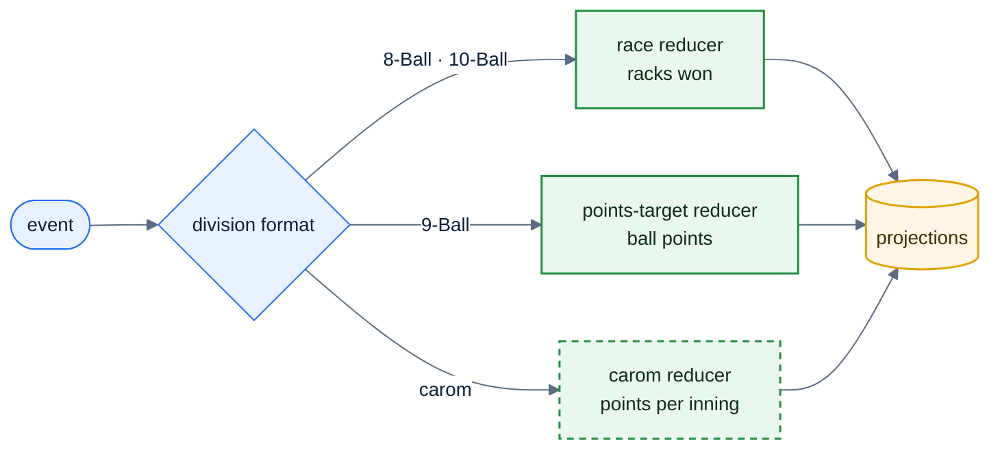

# F52 — 10-Ball & 3-Cushion Carom

> [Feature specs](../README.md) › [E12 — Growth](README.md) › **F52** · Phase 3

| Phase | Status | Rules |
|---|---|---|
| 3 | 🎯 outline | [04 §2](../../04-domain-rules.md) |

## Requirements

| ID | Requirement |
|---|---|
| FR-52.1 | **10-Ball:** a call-shot game played as a race (like 8-Ball). Rack outcomes include legal 10, 10 on a foul (re-spot), break-and-run. Its own race chart and SL range |
| FR-52.2 | **3-Cushion Carom** (popular in Vietnam): points per carom, match to a target per handicap, innings limit; the average (points ÷ innings) is the skill metric |
| FR-52.3 | Formats are data: each format declares its scoring kind (`race`, `points_target`, `carom`), event types and reducer |
| FR-52.4 | The live engine (E07) loads the reducer by format; the TS and Go reducers share fixtures as for 8- and 9-Ball |

## Key rules and assumptions

- Carom doesn't fit the pool "rack" model: a match is a sequence of innings with points, so it gets its own reducer and UI.
- Handicap tables must come from the league.

## Diagram

## Open questions

- Is Carom in scope for this league, or a separate product? Which 10-Ball race chart?

---

[← F51](F51-sponsors.md) · [E12 overview](README.md) · [F53 →](F53-venue-dashboard.md)
