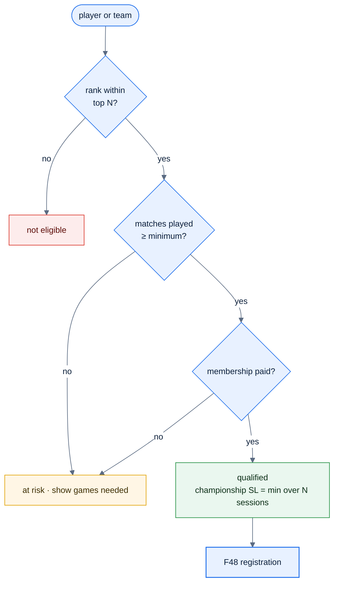

# F54 — Championship qualification tracking

> [Feature specs](../README.md) › [E12 — Growth](README.md) › **F54** · Phase 3

| Phase | Status | Rules |
|---|---|---|
| 3 | 🎯 outline | [04 §12 championship lowest attainable SL](../../04-domain-rules.md) |

## Requirements

| ID | Requirement |
|---|---|
| FR-54.1 | Admins define qualification rules per championship: for example, the top 2 teams per division, a minimum number of matches played per player (e.g. ≥ 6 in the session), paid membership, and an SL rule |
| FR-54.2 | The system shows each team's and player's qualification status live during the session: Qualified · On track · At risk · Not eligible, with the reason |
| FR-54.3 | **Championship lowest attainable SL**: the lowest SL a player has held over the last N sessions is used for tournament handicap |
| FR-54.4 | At the end of the session, the qualified list is frozen and feeds tournament registration (F48) |

## Key rules and assumptions

- Uses standings (F35), per-player MP (F34) and SL history (F18).
- Rules are data (`qualification_rules jsonb`) so they can change per championship.

## Diagram

## Open questions

- The exact qualification rules for the national or city championship.

---

[← F53](F53-venue-dashboard.md) · [E12 overview](README.md)
