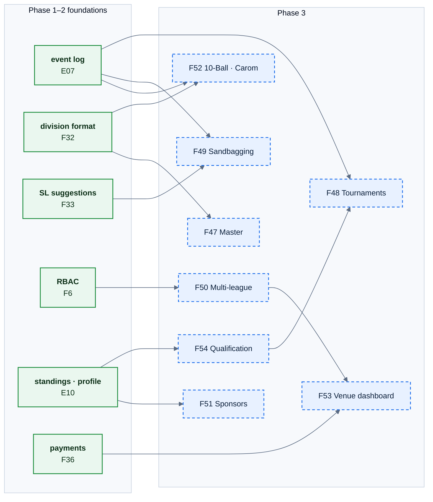

# E12 — Growth

> [Feature specs](../README.md) › **E12**

| | |
|---|---|
| **Goal** | Grow from one league to many: more formats and divisions, tournaments, venue and sponsor value, and protection of the handicap system |
| **Phase** | 3 (outline level: requirements, key rules, one diagram, open questions; no acceptance criteria yet) |
| **Status** | 🎯 Not started. Each item needs a discovery pass before it gets a full spec |
| **Actors** | League Operator (LO), Venue owner, Sponsor, Player, Admin |
| **Related** | [03 scope & phases](../../03-scope-and-phases.md) · [04 §1, §10, §12](../../04-domain-rules.md) · [14 open questions](../../14-open-questions.md) |

## Features by phase

### Phase 1–2

Nothing. Phase 1–2 decisions that keep these doors open: UUID keys everywhere, `format` on divisions (F32), the event log (E07), the outbox (F42), and RBAC tables (F6).

### Phase 3

| # | Feature | Depends on | Status |
|---|---|---|---|
| F47 | [Master division](F47-master-division.md) | F32 | 🎯 |
| F48 | [Tournaments & brackets](F48-tournaments.md) | E07, F54 | 🎯 |
| F49 | [Sandbagging detection](F49-sandbagging-detection.md) | E07, F33 | 🎯 |
| F50 | [Multi-league & LO roles](F50-multi-league.md) | F6 | 🎯 |
| F51 | [Sponsor placements](F51-sponsors.md) | F35 | 🎯 |
| F52 | [10-Ball & 3-Cushion Carom](F52-ten-ball-carom.md) | F32, E07 | 🎯 |
| F53 | [Venue dashboard](F53-venue-dashboard.md) | F50, F36 | 🎯 |
| F54 | [Championship qualification tracking](F54-championship-qualification.md) | F35, F34 | 🎯 |

## Phase 3 deep dive

### How Phase 3 builds on earlier phases

*Suggested order: F50 first (it changes tenancy for everything else), then F54 → F48, then the rest as the business asks.*

### Cross-cutting changes

| Change | Why |
|---|---|
| `league_id` on every top-level table + row-level filter in every query | Multi-league (F50) |
| Formats become data: `formats (code, scoring_kind, sl_range, rules jsonb)` | New games (F52) without schema changes |
| `tournaments`, `brackets`, `bracket_slots` | F48 |
| `anomaly_flags` review queue | F49 |
| `placements` + impression counters | F51 |
