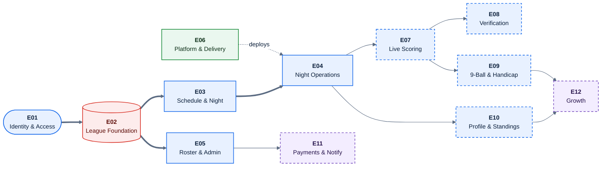
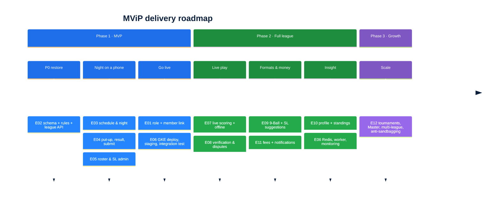
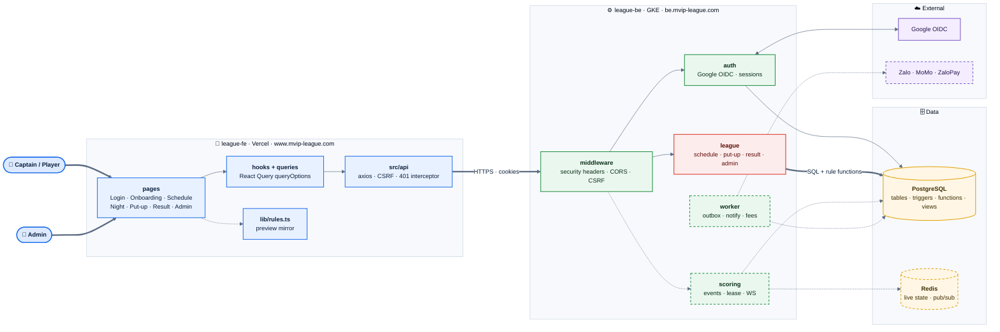
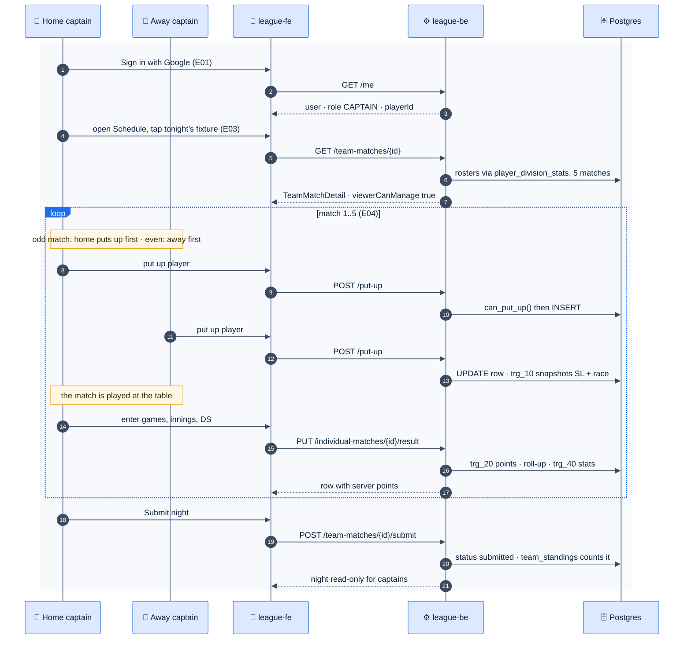
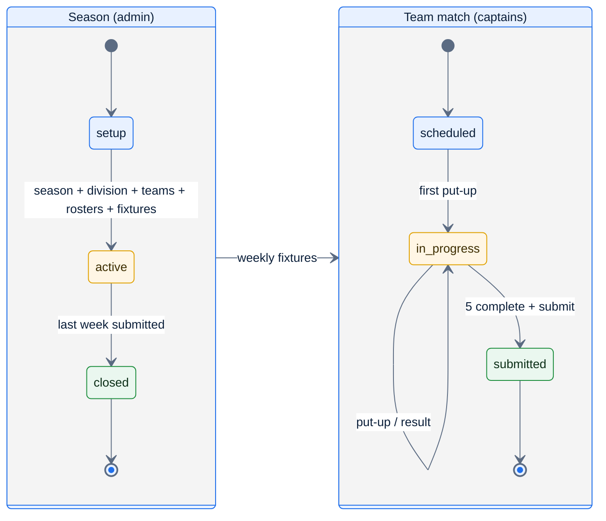
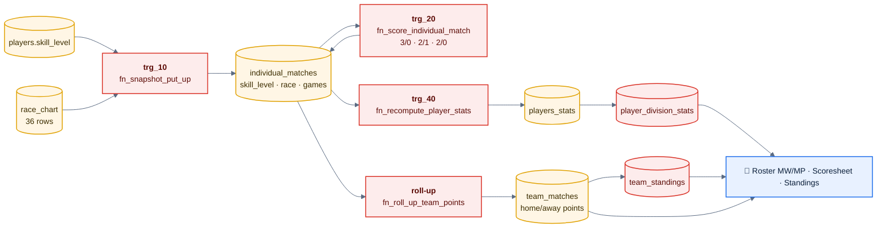
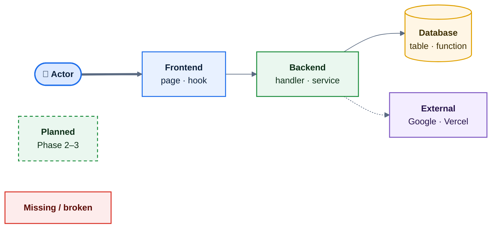

# MViP Feature Specifications

Deep-dive specs for all **54 features**, grouped into **12 epics**.

Layout: **one folder per epic, one file per feature.**

```text
features/
  README.md                      ← you are here: full picture + index
  E01-identity-access/
    README.md                    ← epic: features by phase, Phase 1 and Phase 2 deep dives
    F01-google-sign-in.md        ← feature: requirements · logic · flow · UI · API · edge cases · acceptance
    …
```

Each epic README has a **features-by-phase** table and a **deep dive per phase**: component diagram, key sequence, data delta. Each feature file has its requirements, rules and logic, flow, UI, API and data, edge cases, acceptance criteria and, for Phase 1, the implementation gaps found in the repos. Phase 3 features (E12) are outlines.

Snapshot: 2026-11-10, `league-be@444af15` · `league-fe@fc5bf84`. Parent design: [../README.md](../../../README.md).

## 1. Epics

| Epic | File | Features | Phase | State |
|---|---|---|---|---|
| E01 | [Identity & Access](E01-identity-access/README.md) | F1–F6, F37 | 1, 2 | 🏗 auth built · ❌ role/link API missing |
| E02 | [League Data Foundation](E02-league-foundation/README.md) | F7–F10, F38, F43 | 1, 2 | ❌ P0 blocker |
| E03 | [Schedule & Night View](E03-schedule-night/README.md) | F11, F12, F39a | 1, 2 | 🅿️ parked |
| E04 | [Night Operations](E04-night-operations/README.md) | F13–F15, F39b | 1, 2 | 🅿️ parked |
| E05 | [Roster & Player Admin](E05-roster-admin/README.md) | F16–F19, F39c, F41 | 1, 2 | 🅿️ parked |
| E06 | [Platform & Delivery](E06-platform-delivery/README.md) | F20–F25, F42, F44–F46 | 1, 2 | 🏗 partly |
| E07 | [Live Scoring](E07-live-scoring/README.md) | F26–F30 | 2 | 🎯 |
| E08 | [Score Verification & Disputes](E08-verification-disputes/README.md) | F31 | 2 | 🎯 |
| E09 | [9-Ball & Handicap](E09-nine-ball-handicap/README.md) | F32, F33 | 2 | 🎯 |
| E10 | [Profile & Standings](E10-insights/README.md) | F34, F35 | 2 | 🎯 |
| E11 | [Payments & Notifications](E11-payments-notifications/README.md) | F36, F40 | 2 | 🎯 |
| E12 | [Growth](E12-growth/README.md) | F47–F54 | 3 | 🎯 outline |

F39 (roster rules) is split across three epics: **a** Bye/No-Play weeks → E03, **b** forfeits → E04, **c** roster lock and one team per division → E05.

### 1.1 Epic dependency map



*Thick arrows are the Phase 1 critical path. E02 (red) is the P0 blocker, and dashed boxes are Phase 2–3.*

### 1.2 Roadmap



## 2. Full picture

### 2.1 System components



*Solid boxes exist or are parked. Red = specified but missing from league-be (E02). Dashed = Phase 2.*

### 2.2 A league night, end to end (Phase 1)



*Every number (race, points, totals, stats) is computed in Postgres. The FE only previews.*

### 2.3 Season and team-match lifecycle



### 2.4 Where every number comes from



*Red nodes belong to the missing `00002_business_rules.sql`. Restoring it is E02-F8.*

## 3. Feature index

Status: 🏗 built · 🅿️ parked FE · ❌ specified but missing · ⬜ not started · 🎯 later phase.

| # | Feature | Epic | Phase | Status |
|---|---|---|---|---|
| F1 | [Google sign-in](E01-identity-access/F01-google-sign-in.md) | E01 | 1 | 🏗 |
| F2 | [Sessions & logout](E01-identity-access/F02-sessions-logout.md) | E01 | 1 | 🏗 |
| F3 | [CSRF protection](E01-identity-access/F03-csrf.md) | E01 | 1 | 🏗 |
| F4 | [`/me` with role + playerId](E01-identity-access/F04-me-role-player.md) | E01 | 1 | 🏗 / ❌ |
| F5 | [Onboarding: link member ID](E01-identity-access/F05-onboarding-member-link.md) | E01 | 1 | 🏗 UI / ❌ API |
| F6 | [Role checks + captain-owns-night](E01-identity-access/F06-rbac-captain-owns-night.md) | E01 | 1 | ❌ |
| F7 | [Schema restore (`team_rosters`, CHECKs)](E02-league-foundation/F07-schema-restore.md) | E02 | 1 | ❌ |
| F8 | [Postgres business rules](E02-league-foundation/F08-postgres-business-rules.md) | E02 | 1 | ❌ |
| F9 | [Seed + migrate/seed targets](E02-league-foundation/F09-seed-migrate.md) | E02 | 1 | ❌ |
| F10 | [League API](E02-league-foundation/F10-league-api.md) | E02 | 1 | ❌ |
| F11 | [Schedule](E03-schedule-night/F11-schedule.md) | E03 | 1 | 🅿️ |
| F12 | [Night view & scoresheet](E03-schedule-night/F12-night-view-scoresheet.md) | E03 | 1 | 🅿️ |
| F13 | [Put-up with 23-SL cap](E04-night-operations/F13-put-up-sl-cap.md) | E04 | 1 | 🅿️ |
| F14 | [Result entry](E04-night-operations/F14-result-entry.md) | E04 | 1 | 🅿️ |
| F15 | [Submit night](E04-night-operations/F15-submit-night.md) | E04 | 1 | 🅿️ |
| F16 | [Add paid member](E05-roster-admin/F16-add-paid-member.md) | E05 | 1 | 🅿️ |
| F17 | [Player search](E05-roster-admin/F17-player-search.md) | E05 | 1 | 🅿️ |
| F18 | [Skill-level change & history](E05-roster-admin/F18-skill-level-change.md) | E05 | 1 | 🅿️ |
| F19 | [Player transfer](E05-roster-admin/F19-player-transfer.md) | E05 | 1 | 🅿️ |
| F20 | [PWA, theme, i18n, error copy](E06-platform-delivery/F20-pwa-theme-i18n.md) | E06 | 1 | 🏗 |
| F21 | [CI/CD](E06-platform-delivery/F21-ci-cd.md) | E06 | 1 | 🏗 |
| F22 | [GKE deployment](E06-platform-delivery/F22-gke-deployment.md) | E06 | 1 | ⬜ |
| F23 | [Staging + Google consent screen](E06-platform-delivery/F23-staging-consent.md) | E06 | 1 | ⬜ |
| F24 | [Generated API types + FE/BE integration test](E06-platform-delivery/F24-api-types-integration.md) | E06 | 1 | ⬜ |
| F25 | [Rate limiting, structured logs, vi default](E06-platform-delivery/F25-rate-limit-logs-locale.md) | E06 | 1 | ⬜ |
| F26 | [Coin flip & lag](E07-live-scoring/F26-coin-flip-lag.md) | E07 | 2 | 🎯 |
| F27 | [Live 8-Ball scoring](E07-live-scoring/F27-live-8ball-scoring.md) | E07 | 2 | 🎯 |
| F28 | [Racks & accolades](E07-live-scoring/F28-racks-accolades.md) | E07 | 2 | 🎯 |
| F29 | [Offline scoring sync](E07-live-scoring/F29-offline-sync.md) | E07 | 2 | 🎯 |
| F30 | [Scoring lease & live viewers](E07-live-scoring/F30-scoring-lease-viewers.md) | E07 | 2 | 🎯 |
| F31 | [Dual-captain verification & disputes](E08-verification-disputes/F31-verification-disputes.md) | E08 | 2 | 🎯 |
| F32 | [9-Ball scoring + per-format SL](E09-nine-ball-handicap/F32-nine-ball-scoring.md) | E09 | 2 | 🎯 |
| F33 | [Skill-level suggestions](E09-nine-ball-handicap/F33-sl-suggestions.md) | E09 | 2 | 🎯 |
| F34 | [Player profile](E10-insights/F34-player-profile.md) | E10 | 2 | 🎯 |
| F35 | [Public standings](E10-insights/F35-public-standings.md) | E10 | 2 | 🎯 |
| F36 | [Fees with MoMo / ZaloPay](E11-payments-notifications/F36-fees-payments.md) | E11 | 2 | 🎯 |
| F37 | [Zalo login & Mini App](E01-identity-access/F37-zalo-login-mini-app.md) | E01 | 2 | 🎯 |
| F38 | [Generated Member ID & Team ID](E02-league-foundation/F38-generated-ids.md) | E02 | 2 | 🎯 |
| F39 | Roster rules (a: bye/no-play, b: forfeit, c: lock + per-division) [a](E03-schedule-night/F39a-bye-no-play.md) · [b](E04-night-operations/F39b-forfeits.md) · [c](E05-roster-admin/F39c-roster-lock.md) | E03/E04/E05 | 2 | 🎯 |
| F40 | [Notifications](E11-payments-notifications/F40-notifications.md) | E11 | 2 | 🎯 |
| F41 | [Audit log](E05-roster-admin/F41-audit-log.md) | E05 | 2 | 🎯 |
| F42 | [Worker, outbox, Redis](E06-platform-delivery/F42-worker-outbox-redis.md) | E06 | 2 | 🎯 |
| F43 | [Migration tool](E02-league-foundation/F43-migration-tool.md) | E02 | 2 | 🎯 |
| F44 | [Monitoring & error tracking](E06-platform-delivery/F44-monitoring.md) | E06 | 2 | 🎯 |
| F45 | [Playwright E2E](E06-platform-delivery/F45-playwright-e2e.md) | E06 | 2 | 🎯 |
| F46 | [Load testing](E06-platform-delivery/F46-load-testing.md) | E06 | 2 | 🎯 |
| F47 | [Master division](E12-growth/F47-master-division.md) | E12 | 3 | 🎯 |
| F48 | [Tournaments & brackets](E12-growth/F48-tournaments.md) | E12 | 3 | 🎯 |
| F49 | [Sandbagging detection](E12-growth/F49-sandbagging-detection.md) | E12 | 3 | 🎯 |
| F50 | [Multi-league & LO roles](E12-growth/F50-multi-league.md) | E12 | 3 | 🎯 |
| F51 | [Sponsor placements](E12-growth/F51-sponsors.md) | E12 | 3 | 🎯 |
| F52 | [10-Ball & 3-Cushion Carom](E12-growth/F52-ten-ball-carom.md) | E12 | 3 | 🎯 |
| F53 | [Venue dashboard](E12-growth/F53-venue-dashboard.md) | E12 | 3 | 🎯 |
| F54 | [Championship qualification tracking](E12-growth/F54-championship-qualification.md) | E12 | 3 | 🎯 |

## 4. How to read a feature spec

| Section | Contents | IDs |
|---|---|---|
| Requirements | User story + numbered functional requirements | `FR-<n>.<m>` |
| Rules & logic | Pseudo-code, decision tables, state diagrams; rule IDs from [04](../04-domain-rules.md) | `R-xxx` |
| Flow | Sequence or activity diagram | — |
| UI | Screens, states, copy keys (`en.json`) | — |
| API & data | Endpoints, fields, tables, functions, error codes | — |
| Edge cases | Situation → expected behavior | `EC-<n>.<m>` |
| Acceptance criteria | Given / When / Then | `AC-<n>.<m>` |
| Implementation gaps | Phase 1: where the parked or live code differs from this spec | — |

## 5. Diagram legend

All diagrams share one theme (`base`, app blue `#1F6FEB`, Arial) and one colour key:



| Mark | Meaning |
|---|---|
| Thick arrow `==>` | Primary path |
| Solid arrow | Runtime call |
| Dotted arrow | Async, optional or planned |
| Dashed border | Planned (Phase 2–3) |
| Red fill | Specified but missing from the repo, or broken |
| Sequence green / red bands | Success / failure branch |
| Sequence amber notes | Business rules (`R-xxx`) |
